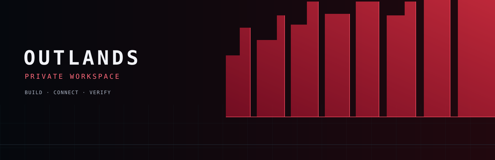
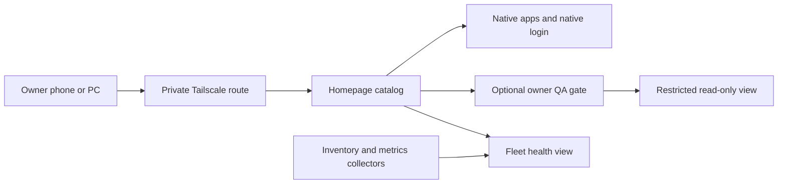

<p align="center"></p>

# OUTLANDS · Private Workspace Blueprint

Build a private, branded home for your self-hosted applications with Homepage,
Docker, Tailscale and a deliberate owner-access boundary.

This is a public learning guide with original example configuration and artwork.
Start with a local Homepage, add one private route, verify who can open it, then
bring apps and monitoring into the catalog one at a time. It is an early
reference blueprint, not a complete production installer or a claim that every
application can share the same theme, credentials or read-only API.

Original materials are [MIT licensed](LICENSE). Applications and their brands
keep their [upstream licenses](docs/third-party.md).

## What you can build

| Layer | Purpose | Boundary |
|---|---|---|
| Homepage | One branded app catalog | Links do not grant access to an app. |
| Tailscale Serve | Private HTTPS entry points | Tailnet access still needs explicit policy and app authorization. |
| Authentik | Optional owner-only Browser QA gate | A QA gate does not automatically unify native app accounts. |
| Grafana and Prometheus | Dashboards and node health | Keep native Grafana login until a separately tested identity migration. |
| Fleet overview | Inventory, freshness and health | Project only needed fields; distinguish offline, unavailable and not connected. |
| Native apps | AI, learning, containers and other tools | Theme and API support differ by product and version. |



## Start here

1. Read the [architecture](docs/01-architecture.md) and [build path](docs/02-build-path.md).
2. Review the [local Homepage example](examples/homepage/README.md). It binds only
   to `127.0.0.1:3000`, mounts no Docker socket and requires you to select an image.
3. Add private access using the upstream Tailscale Serve guide, then verify the
   [access and QA matrix](docs/03-access-and-qa.md) before adding privileged tools.
4. Apply the [black/red branding](docs/04-branding.md), then document
   [operations, backup and rollback](docs/05-operations.md).
5. Try the [Dockhand cyberpunk theme walkthrough](docs/06-dockhand-cyberpunk.md):
   a local fictional demo, clean screenshots and a staged native-adapter path.

```sh
# Read-only checks on this source checkout; no container or network activity.
python3 -I -B scripts/check_public_source.py
```

The example's `compose.yaml`, `.env.example`, `config/` and `assets/` live under
`examples/homepage/`. Work there when following the example commands. Nothing
in this repository automatically starts an app, joins a tailnet, creates an
identity provider, imports secrets or changes an existing server.

## Design direction

Charcoal surfaces, a red digital-wall motif, clear service labels and restrained
status colors create a consistent OUTLANDS workspace. Original SVG assets are
included. They contain no game artwork, game logos, external fonts or live
infrastructure screenshots. Use app-native theme settings where possible;
version-specific CSS should remain separate, reversible and tested on mobile.

## Validation status

Source checks and local Compose resolution are separate from an application
boot, owner-login test, recovery exercise or physical-device check. Read
[VALIDATION.md](VALIDATION.md) for exactly what was checked. This public example
has not been deployed as a complete stack. The QA table begins with **NOT RUN**
so you can record evidence for your own installation.

## Contribute

Questions, setup notes, accessibility improvements and reproducible bug reports
are welcome. Describe what you tried and the result you expected. You do not
need to contribute code to improve this guide. Read [CONTRIBUTING.md](CONTRIBUTING.md)
and omit credentials, private hostnames, device identities and live logs.

See [CHANGELOG.md](CHANGELOG.md) for the initial scope and
[SECURITY.md](SECURITY.md) for reporting sensitive findings.
