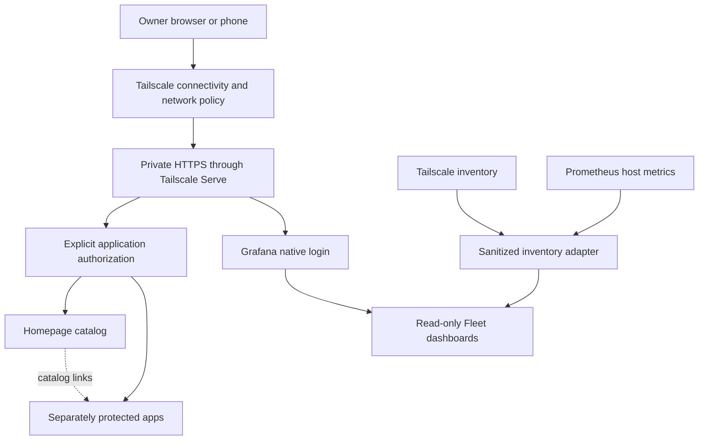

# Architecture: a private place to find your apps

Build one recognizable front door for a collection of independently operated apps. Homepage provides the catalog. Docker runs the apps. Tailscale Serve provides private HTTPS access from permitted tailnet devices. Each app still needs an explicit authorization decision.

This is an original, sanitized tutorial. Its diagrams describe a proposed build. They are not a record of a live installation, a security audit, or proof of production readiness. All names and URLs in the examples are placeholders.

## The layers

The diagram shows trust decisions, not a ready-made proxy configuration. The identity gate for an application must be on the path to that application. Protecting the catalog alone does not protect the apps its links open.

| Component | Responsibility | Boundary to preserve |
| --- | --- | --- |
| Homepage | Catalog, descriptions, categories, links, selected status widgets | A visible tile does not grant access to its destination |
| Docker | App processes, networks, volumes, versioned images | Each app keeps its own state and upgrade plan |
| Tailscale Serve | Private HTTPS route to a local service | Network reachability does not establish owner-only authorization |
| Authentik | Candidate identity and application policy layer | Keep new integrations behind the owner Browser QA gate |
| Grafana | Native login and visualization | Shared app sign-in remains deferred in this blueprint |
| Prometheus | Collect and query host metrics | A successful scrape describes telemetry availability |
| Fleet adapter | Join approved inventory and metric fields | Expose an allowlisted read-only projection, never a general proxy |

Serve routes services within a tailnet and applies tailnet access controls. Funnel is a different feature that exposes a service to the internet. This build uses Serve. Do not enable Funnel to make private workspace links work. [Tailscale Serve](https://tailscale.com/docs/features/tailscale-serve), [Funnel scope](https://tailscale.com/docs/features/tailscale-funnel)

## Two independent access questions

1. Can this device and identity reach the service through the network policy?
2. Is this user authorized to use this specific application?

The tutorial's intended application audience is the owner identity, represented only as `owner@example.com`. An authenticated tailnet member must not inherit app permission by proximity. Use explicit application bindings and test an authenticated but unassigned account. Authentik documents that a target without applicable bindings passes; an empty policy list is not a deny rule. [Authentik bindings](https://docs.goauthentik.io/add-secure-apps/bindings-overview/)

Homepage currently offers its own password or OIDC gate. An exact `HOMEPAGE_ALLOWED_HOSTS` list is a request guard, not a user authorization policy. Keep host validation and authentication as separate decisions. Choose and test one supported catalog sign-in design for the installed version before private remote use. [Homepage installation and authentication](https://gethomepage.dev/installation/)

## Fleet means observation

Fleet is the workspace's inventory view in this guide; it does not refer to a separate product named Fleet. Combine a minimal Tailscale device inventory with Prometheus CPU, RAM, disk, and uptime measurements. A stable, private mapping should join records; display aliases can be generic. Tailscale presence alone cannot supply those host resource measurements. Node Exporter is one upstream option for Linux host metrics. [Tailscale CLI](https://tailscale.com/docs/reference/tailscale-cli), [Node Exporter guide](https://prometheus.io/docs/guides/node-exporter/)

Show freshness alongside each source. A missing scrape, sleeping device, stale record, and measured zero are different states. Keep raw network inventory and metric labels private. No restart, shell, process, container, account, or deletion controls belong in this dashboard.

Next: [build the layers incrementally](02-build-path.md).
