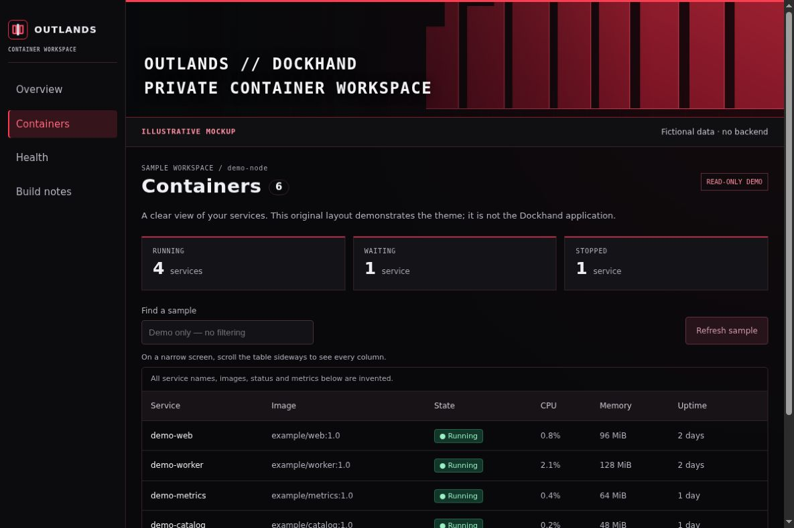
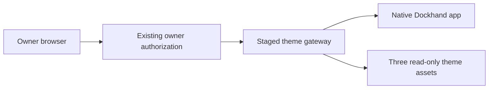
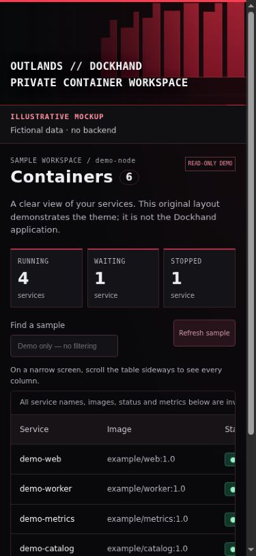

# Give Dockhand an OUTLANDS cyberpunk theme

Build a charcoal-and-red container workspace with a digital-wall banner, an
original logo and readable status labels. Start with the local demo, learn what
the CSS changes, then stage an adapter for your own Dockhand version.

**The screenshots below are ILLUSTRATIVE MOCKUPS with fictional data.** They
show this repository's original static fixture, not a real installation or a
copy of Dockhand's application UI. No private dashboard capture is included.



## 1. Open a local demo first

You need a downloaded copy of this repository and Python 3.9 or newer. You do
not need Docker, a tailnet, an account or a running Dockhand installation for
this step.

1. Download the repository using **Code → Download ZIP**, then extract it.
2. Open a terminal in the extracted repository directory, beside `README.md`.
3. Run:

```sh
python3 -I -B examples/dockhand-theme/serve_demo.py
```

On Windows, use `python` if that is the name of your Python executable.
Open the loopback URL printed in the terminal. The default is
`http://127.0.0.1:8765/demo/`. If that port is already in use, stop and choose
another with `--port 8766`; this example does not replace an existing server.

You should see the red wall, OUTLANDS navigation and six sample containers.
The **ILLUSTRATIVE MOCKUP** label stays visible at desktop and narrow widths.
Search and refresh are disabled because this page has no backend. It makes no
Docker/API connections, runs no JavaScript and displays no live metrics.
Press **Ctrl+C** in the terminal when you finish.

This address belongs to the computer running Python. Opening `127.0.0.1` on a
phone opens the phone itself. Use desktop responsive tools for the local demo;
test a real phone only after separately configuring private access to a staged
installation. Do not change this preview server to listen publicly.

## 2. Find the three theme files

Everything the theme needs is in
[`examples/dockhand-theme/theme/`](../examples/dockhand-theme/theme/):

```text
theme/
  netwall.css
  assets/
    netwall.svg
    mark.svg
```

- `netwall.css` sets the color variables, banner, selected-navigation treatment
  and focus outlines. Its relative artwork URLs keep all assets on one origin.
- `netwall.svg` is an original geometric wall derived from the blueprint's
  already-public artwork. It contains no franchise assets or external fonts.
- `mark.svg` is the original OUTLANDS symbol. Replace it with your own original
  mark when making a workspace for someone else.

The [demo layout](../examples/dockhand-theme/demo/base.css) supplies only the
fixture's structure. **Do not copy that layout stylesheet into Dockhand.** The
native adapter is `theme/netwall.css`; its selectors still need compatibility
review against the app you actually run.

## 3. Make a small design change

Edit a copy of `theme/netwall.css` in your local demo. For example:

```css
/* HSL values used by the native-style color variables. */
--primary: 354 95% 62%;
--background: 240 8% 4%;
```

Keep the wall's left side quiet so the title remains readable. Make one change,
reload the demo and compare desktop and narrow views. Give meaningful states
both text and color: Running, Waiting and Stopped in this fixture. In a real app,
preserve its native state meanings, disabled controls and keyboard focus.

This adapter overrides appearance only. CSS cannot make a privileged Docker API
read-only, verify an owner identity or change who can reach an application.
Review [access and QA](03-access-and-qa.md) before adding real infrastructure.

## 4. Check the native Dockhand version

Use the [official Dockhand manual](https://dockhand.pro/manual/) for installation
and supported appearance settings. It documents light/dark appearance and font
controls. Start with supported settings before adding a version-specific CSS
layer. The upstream [source repository](https://github.com/Finsys/dockhand)
identifies the application and its own license; no vendor source is bundled here.

This CSS was derived against the 1.0.43-era interface. Selectors such as
`main.bg-background`, `[data-sidebar="sidebar"]` and
`img[alt="Dockhand Logo"]` are implementation details, not a supported stable
custom-CSS API. Record your installed version and inspect its rendered elements
before adapting them. A newer release may need different selectors.

The mockup intentionally supplies a similar HTML structure to exercise the
adapter. Successful demo rendering does **not** validate native Dockhand
compatibility, authorization, container actions or stream delivery.

## 5. Stage a separate theme entry

Keep your existing app entry available while you test a new presentation layer.
Write down the baseline first: native app image/version, gateway configuration,
data locations, owner policy, existing routes and how to restore the gateway.
Keep those operational notes private.

A typical separation looks like this:



Use fictional names in shared examples, such as `dockhand.workspace.example`
and `demo-node`. Configure real names privately. A Homepage tile is a link; it
does not supply downstream authorization. Keep Grafana's native login separate
and defer shared app sign-in while testing this visual change.

The theme directory can be mounted read-only in an **existing, reviewed** gateway:

```yaml
# Fragment for a private working copy; not a complete Compose service.
volumes:
  - type: bind
    source: ./examples/dockhand-theme/theme
    target: /opt/outlands-theme
    read_only: true
    bind:
      create_host_path: false
```

The relative source assumes that repository-root directory is the Compose
project directory. Adjust it deliberately if your working copy lives elsewhere.
Preserve the existing gateway's image pin, user, startup, network, security flags,
resource limits, config mounts and authorization behavior. Adding a mount may
require a gateway recreation; changing a host file alone cannot add a container
mount. Recreate only the staged gateway after review, with rollback prepared.

A read-only asset mount protects the files. It does not restrict Docker actions.
This tutorial supplies no Docker socket connection, identity provider, native
API allowlist or production deployment command.

## 6. Deliver the CSS through the existing owner gate

If you use an Nginx HTML overlay, check that its build includes
`ngx_http_sub_module`. The official module documentation explains the
[HTML replacement filter](https://nginx.org/en/docs/http/ngx_http_sub_module.html):
it is an optional build module and filters `text/html` by default. Keep this
operation away from JavaScript, JSON and event streams. The asset-location
fragment also requires the Nginx auth-request module; a syntax failure stops
the staged change.

The [HTML overlay fragment](../examples/dockhand-theme/nginx-html-overlay.example.inc)
shows the small insertion inside an **existing owner-protected proxy location**:

```nginx
proxy_set_header Accept-Encoding "";
sub_filter_once on;
sub_filter '</head>' '<link rel="stylesheet" href="/__outlands/theme/netwall.css"></head>';
```

Before enabling it, privately verify uncompressed HTML with one closing head
marker, the actual response's content type, and a CSP that permits the intended
same-origin stylesheet and artwork. Preserve the application's existing CSP;
do not weaken it to force the theme to work. A missing marker, compressed body,
or incompatible CSP is a reason to stop and inspect the staged design.

Use the [asset-location fragment](../examples/dockhand-theme/nginx-theme-assets.example.conf)
to understand exact paths, GET/HEAD restrictions and `auth_request` on **each**
asset. Its placeholder owner check returns **403 for everyone**. It must be
replaced with a separately verified owner-auth integration before a real user
can load assets. The fragments cannot be deployed as a working gateway by
themselves and do not establish a read-only Docker boundary.

When adapting that fragment:

- Keep unknown files, encoded aliases, directory requests and query variants
  denied; add only the three needed files to the owner-protected static routes.
- Preserve Host validation and rejected write/upgrade requests from your existing
  gateway. Adding a `proxy_set_header` at a child level also affects inherited
  proxy headers: merge the required existing header list rather than dropping it.
  Do not forward caller identity or credentials to a different backend.
- Nginx `add_header` directives in a location affect inherited headers. Merge all
  required parent security, CSP and session-refresh headers into the final design.
  The sample asset headers alone are not a complete authentication integration.
- Avoid `return 200` as an asset handler in an authorization location: Nginx's
  rewrite phase can finish before access checks. Static file delivery should
  occur after a successful authorization subrequest.
- Keep CSS and artwork together, with correct MIME types and a deliberate cache
  policy. The example uses `private, no-store`; if you later choose versioned
  caching, version the filename and retest a reload.

For the access and header behavior, consult the official
[Nginx auth-request module](https://nginx.org/en/docs/http/ngx_http_auth_request_module.html),
[rewrite processing order](https://nginx.org/en/docs/http/ngx_http_rewrite_module.html)
[response-header inheritance](https://nginx.org/en/docs/http/ngx_http_headers_module.html)
and [proxy-header inheritance](https://nginx.org/en/docs/http/ngx_http_proxy_module.html#proxy_set_header).

Run the gateway's syntax check against the reviewed candidate before a reload or
recreation. Do not patch native application JavaScript, replace vendor bundles
or expose new API paths as part of a theme change.

## 7. Verify desktop and mobile

The portrait capture below is also an original static mockup with invented data.
It demonstrates a visible banner and a table that scrolls inside the page.



For **your staged native installation**, record results for each row below.
The mockup checks in this repository do not pre-fill your native acceptance.

| Check | Expected result | Your native result |
|---|---|---|
| Signed-out request | Owner gate denies or starts the approved owner login. | NOT RUN |
| Wrong account or forged identity headers | Access remains denied. | NOT RUN |
| CSS and both artwork files | Owner-protected; correct MIME and expected hashes. | NOT RUN |
| Desktop and portrait | Readable text, visible banner, no whole-page sideways scrolling. | NOT RUN |
| Landscape | Usable content area; reduce banner height if it crowds the table. | NOT RUN |
| Reload and asset cache | Correct theme survives a fresh navigation and reload. | NOT RUN |
| Table scrolling and keyboard focus | Every required column is reachable; focus remains visible. | NOT RUN |
| Read-only and stream behavior | Existing restrictions hold; reviewed numeric stats still update. | NOT RUN |
| iPhone Safari with private connectivity | Same owner boundary and usable layout on a physical device. | NOT RUN |
| Existing app entry and rollback | Prior entry still works; tested recovery restores it. | NOT RUN |

If an optional event feed is outside your reviewed read-only routes, do not open
it merely to remove a console warning. First distinguish that warning from the
numeric-statistics stream and a page-loading failure. A theme should not expand
an API permission boundary.

## 8. Promote or roll back deliberately

After native desktop, mobile and authorization checks pass, prepare the small
change that moves the accepted theme to your normal app entry. Revalidate that
entry's own gate and settings; a successful staging URL does not prove another
route is protected.

On a failed check, stop and keep the existing app available. Restore the known
gateway configuration and theme files using your recorded procedure. If a
container was replaced, reconcile old/new container IDs, start times and mounts
before using an older rollback script. Keep the app's data and native login
unchanged. A backup file alone is not a completed restore test.

## What was tested here

See [VALIDATION.md](../VALIDATION.md) for source screening, the local mockup and
responsive screenshot checks. The distributed Nginx fragments have not been
installed against a native Dockhand deployment as part of this public example.
A public demo screenshot proves only the state of that demo.

Original text, CSS, SVG assets and fictional-fixture screenshots use the
[repository MIT license](../LICENSE). Dockhand and other upstream projects keep
their own licenses and trademarks. The design uses original geometric artwork;
it includes no Cyberpunk 2077 game imagery or vendor application screenshots.
