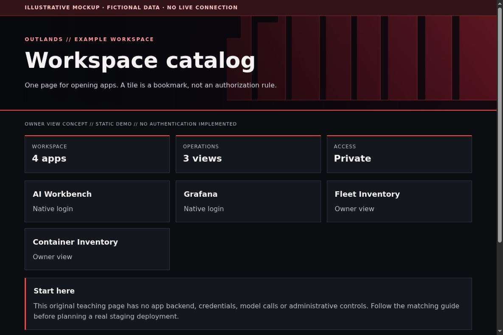

# Homepage: build your front door

[All app walkthroughs](07-app-walkthroughs.md) · [Architecture](01-architecture.md) · [Access and QA](03-access-and-qa.md)

One page for opening apps. A tile is a bookmark, not an authorization rule.



This is a screenshot of an original HTML teaching fixture, not a screenshot of the native app or a live deployment. It contains only invented data. Native appearance and supported customization vary by release.

## 1. Try the local example first

You need Python 3.9+ and a browser for this static demo. From the repository root:

```sh
python3 -I -B examples/app-tour/serve_demo.py --port 8766
```

Open `http://127.0.0.1:8766/homepage.html`. Stop the server with Ctrl+C when finished. It serves only the fixed demo files on loopback. It has no app APIs, identity sessions, collector, automatic refresh or Docker connection. See the [demo README](../examples/app-tour/README.md).

## 2. Set up a separate staging copy

Start with the existing [local Homepage example](../examples/homepage/README.md). Install Docker using its official instructions, select a specific Homepage release, and fill only the image selection in your local copy of `.env.example`. Follow that example from its own directory. Its Compose service binds to loopback and has no Docker socket. Keep the config and artwork in separate mounts so a theme edit does not require changing the app image.

Create one service group before adding widgets. A group contains named services; each service has an `href` and a description. The following is a native `services.yaml` example with deliberately unresolvable destinations:

```yaml
- Workspace:
    - AI Workbench:
        href: https://ai.example.invalid/
        description: Native login
    - Fleet Inventory:
        href: https://fleet.example.invalid/
        description: Owner-only viewer
```

Replace each destination locally after checking the app's own access boundary. Begin with links only. Widgets can require API credentials and broader access, so add them as a separate reviewed change. Do not mount the Docker socket just to show a list of links.

## 3. Match the OUTLANDS design

Use `custom.css` and original local artwork from the Homepage example. Keep the red wall visible above the fold on narrow screens. Use charcoal cards with readable white text, not red text for every status. Give each icon a text label; do not make the icon the only navigation clue. Check the release's supported CSS hooks before extending selectors.

The [shared demo CSS](../examples/app-tour/tour.css) styles our own fixtures only. It is not a universal injection stylesheet. Keep dark surfaces, a red wall, visible focus, clear labels and distinct status meanings. Prefer supported native customization; hold an adapter when the installed version has not been reviewed.

## 4. Add a safe Homepage link

In your private Homepage `services.yaml`, add the staging destination only after checking its access boundary. A fictional native Homepage entry looks like this:

```yaml
- Examples:
    - Workspace catalog:
        href: https://homepage.example.invalid/
        description: Private staging · verify access separately
```

Replace the address locally. A link does not implement owner-only access. Use a private route, an explicit owner gate where needed, and the app's native login. Keep Grafana on its own password and defer shared app sign-in. No identity or networking state is created by this example.

## 5. Verify before promoting

| Check | Reader's real staging result |
| --- | --- |
| Homepage link opens the intended app and path | NOT RUN |
| Native app version and data location recorded privately | NOT RUN |
| Owner allowed; signed-out and non-owner users denied | NOT RUN |
| Portrait, landscape, keyboard focus and reload usable | NOT RUN |
| No secrets/private data in screenshots or browser errors | NOT RUN |
| Observer route cannot perform app mutations | NOT RUN |
| Prior working release can be restored | NOT RUN |

Check both phone and PC. A browser viewport simulation is useful but does not replace a physical-device check. Do not equate an HTML response, fixture screenshot or source validation with end-to-end app acceptance.

## 6. Troubleshoot and roll back

If a tile opens the wrong app, check the full scheme, host, port and path. If artwork is absent, check the asset path and the browser's cached stylesheet. Revert only your config/CSS backup to undo a theme; keep the image and data volumes unchanged.

Keep a timestamped private backup before any approved native theme edit. Change one app at a time. Stop on unexpected behavior instead of repeatedly recreating containers. Use the [operations checklist](05-operations.md) to distinguish a visual rollback from restoring application data.

## Official reference

Use the [official Workspace catalog reference](https://gethomepage.dev/configs/services/) for the exact version you deploy. Checked 2026-10-23. Original fixture/source checks and Browser verification are recorded separately in [VALIDATION.md](../VALIDATION.md). Upstream terms remain separate from this repository's MIT license; see [third-party boundaries](third-party.md).
