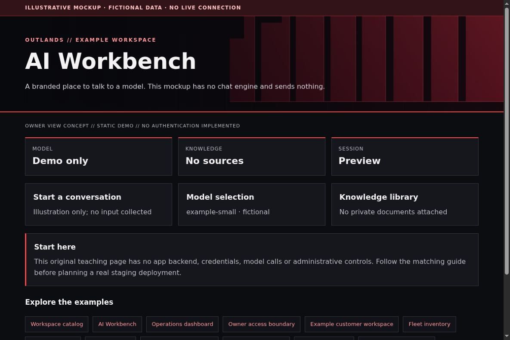

# AI Workbench: Open WebUI without losing your data

[All app walkthroughs](07-app-walkthroughs.md) · [Architecture](01-architecture.md) · [Access and QA](03-access-and-qa.md)

A branded place to talk to a model. This mockup has no chat engine and sends nothing.



This is a screenshot of an original HTML teaching fixture, not a screenshot of the native app or a live deployment. It contains only invented data. Native appearance and supported customization vary by release.

## 1. Try the local example first

You need Python 3.9+ and a browser for this static demo. From the repository root:

```sh
python3 -I -B examples/app-tour/serve_demo.py --port 8766
```

Open `http://127.0.0.1:8766/ai-workbench.html`. Stop the server with Ctrl+C when finished. It serves only the fixed demo files on loopback. It has no app APIs, identity sessions, collector, automatic refresh or Docker connection. See the [demo README](../examples/app-tour/README.md).

## 2. Set up a separate staging copy

Use the official Open WebUI quick start for the release you choose. Before deploying, identify the persistent data volume, model provider endpoint and authentication settings. In an existing installation, record the full Compose input set and exact image digest privately. Keep the current secret key and database; changing the key while installing a theme can break sessions or protected values.

For a new staging instance, use a fresh test data volume and a separately selected model provider. Do not point staging at production chat data. The native settings below illustrate the desired authentication posture; review them against your release's environment reference before use:

```yaml
environment:
  WEBUI_AUTH: "true"
  ENABLE_SIGNUP: "false"
```

Some settings persist in the database and override later environment changes. Check the [environment reference](https://docs.openwebui.com/reference/env-configuration/) and verify the effective signup setting in staging; do not reset a data volume to force settings.

Bootstrap the first owner using the documented flow, then close signup before exposing a route. This fragment is not a complete Compose service and contains no admin password or session secret. A working sign-in page does not prove model inference or document retrieval works.

## 3. Match the OUTLANDS design

Review [Open WebUI's license](https://docs.openwebui.com/license/) and branding requirements for your selected version before redistributing a customized image or removing product marks. This repo does not grant an exemption. Prefer supported appearance options. If your version needs a CSS build adapter, first prove the deployment can be reproduced with the same startup, mounts, environment and image settings. Change only static assets in a staging image; use versioned stylesheet URLs so clients receive the new design. Do not copy the mockup CSS into unknown native selectors.

The [shared demo CSS](../examples/app-tour/tour.css) styles our own fixtures only. It is not a universal injection stylesheet. Keep dark surfaces, a red wall, visible focus, clear labels and distinct status meanings. Prefer supported native customization; hold an adapter when the installed version has not been reviewed.

## 4. Add a safe Homepage link

In your private Homepage `services.yaml`, add the staging destination only after checking its access boundary. A fictional native Homepage entry looks like this:

```yaml
- Examples:
    - AI Workbench:
        href: https://ai-workbench.example.invalid/
        description: Private staging · verify access separately
```

Replace the address locally. A link does not implement owner-only access. Use a private route, an explicit owner gate where needed, and the app's native login. Keep Grafana on its own password and defer shared app sign-in. No identity or networking state is created by this example.

## 5. Verify before promoting

| Check | Reader's real staging result |
| --- | --- |
| Homepage link opens the intended app and path | NOT RUN |
| Native app version and data location recorded privately | NOT RUN |
| Owner allowed; signed-out and non-owner users denied | NOT RUN |
| Portrait, landscape, keyboard focus and reload usable | NOT RUN |
| No secrets/private data in screenshots or browser errors | NOT RUN |
| Observer route cannot perform app mutations | NOT RUN |
| Prior working release can be restored | NOT RUN |

Check both phone and PC. A browser viewport simulation is useful but does not replace a physical-device check. Do not equate an HTML response, fixture screenshot or source validation with end-to-end app acceptance.

## 6. Troubleshoot and roll back

A page that stays blue can be a cached stylesheet; inspect the loaded asset before rebuilding. A blank page may be a failed bundle or content-security policy, not a model failure. Keep a known working image and Compose input set for rollback. Restore the image/static layer without overwriting chats, model choices, RAG settings or credentials. Verify sign-in and a harmless model test separately, with the owner's approval.

Keep a timestamped private backup before any approved native theme edit. Change one app at a time. Stop on unexpected behavior instead of repeatedly recreating containers. Use the [operations checklist](05-operations.md) to distinguish a visual rollback from restoring application data.

## Official reference

Use the [official AI Workbench reference](https://docs.openwebui.com/getting-started/quick-start/) for the exact version you deploy. Checked 2026-10-23. Original fixture/source checks and Browser verification are recorded separately in [VALIDATION.md](../VALIDATION.md). Upstream terms remain separate from this repository's MIT license; see [third-party boundaries](third-party.md).
