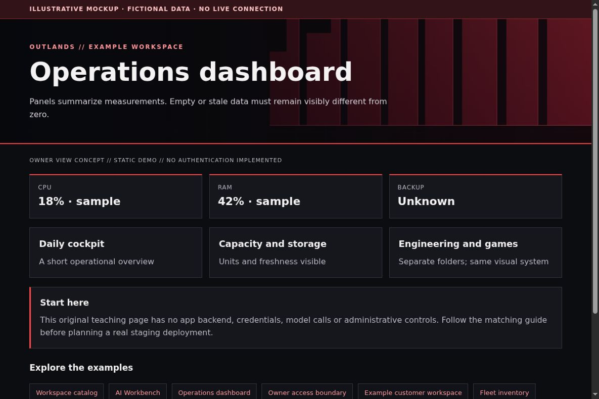

# Grafana: one visual language across dashboards

[All app walkthroughs](07-app-walkthroughs.md) · [Architecture](01-architecture.md) · [Access and QA](03-access-and-qa.md)

Panels summarize measurements. Empty or stale data must remain visibly different from zero.



This is a screenshot of an original HTML teaching fixture, not a screenshot of the native app or a live deployment. It contains only invented data. Native appearance and supported customization vary by release.

## 1. Try the local example first

You need Python 3.9+ and a browser for this static demo. From the repository root:

```sh
python3 -I -B examples/app-tour/serve_demo.py --port 8766
```

Open `http://127.0.0.1:8766/grafana.html`. Stop the server with Ctrl+C when finished. It serves only the fixed demo files on loopback. It has no app APIs, identity sessions, collector, automatic refresh or Docker connection. See the [demo README](../examples/app-tour/README.md).

## 2. Set up a separate staging copy

Install a selected Grafana release following the upstream guide, with persistent storage for its database. Keep the native username/password login. Do not add OAuth while changing the design. Create a viewer account for observation and keep administrator access separate.

Add a Prometheus data source in a staging Grafana, using the internal address appropriate to that staging network. In Grafana, a data source defines where panels query measurements; a dashboard is a saved arrangement of panels. Start with one CPU or availability panel, not a complete imported operations suite. A native data-source provisioning fragment can look like this:

```yaml
apiVersion: 1
datasources:
  - name: Example Metrics
    type: prometheus
    access: proxy
    url: http://metrics.example.invalid:9090
    isDefault: true
    editable: false
```

The address intentionally does not resolve. Configure authentication separately if your data source requires it. Export a dashboard before editing, and record its UID so Homepage links remain stable. Provisioned files and UI edits have different persistence behavior; follow the provisioning documentation for your version.

## 3. Match the OUTLANDS design

Use the native dark theme, consistent panel titles, spacing and original banner art where supported. Match red accents without changing metric queries, units, thresholds or alert meanings. Do not recolor a healthy state red simply for the brand. Keep panel text large enough for phones. A row for operations, another for capacity and a short incident view often work better than one giant dashboard. This one guide covers the daily, node, mobile, incident, fleet, storage, engineering and game monitoring dashboard roles.

The [shared demo CSS](../examples/app-tour/tour.css) styles our own fixtures only. It is not a universal injection stylesheet. Keep dark surfaces, a red wall, visible focus, clear labels and distinct status meanings. Prefer supported native customization; hold an adapter when the installed version has not been reviewed.

## 4. Add a safe Homepage link

In your private Homepage `services.yaml`, add the staging destination only after checking its access boundary. A fictional native Homepage entry looks like this:

```yaml
- Examples:
    - Operations dashboard:
        href: https://grafana.example.invalid/
        description: Private staging · verify access separately
```

Replace the address locally. A link does not implement owner-only access. Use a private route, an explicit owner gate where needed, and the app's native login. Keep Grafana on its own password and defer shared app sign-in. No identity or networking state is created by this example.

## 5. Verify before promoting

| Check | Reader's real staging result |
| --- | --- |
| Homepage link opens the intended app and path | NOT RUN |
| Native app version and data location recorded privately | NOT RUN |
| Owner allowed; signed-out and non-owner users denied | NOT RUN |
| Portrait, landscape, keyboard focus and reload usable | NOT RUN |
| No secrets/private data in screenshots or browser errors | NOT RUN |
| Observer route cannot perform app mutations | NOT RUN |
| Prior working release can be restored | NOT RUN |

Check both phone and PC. A browser viewport simulation is useful but does not replace a physical-device check. Do not equate an HTML response, fixture screenshot or source validation with end-to-end app acceptance.

## 6. Troubleshoot and roll back

When a panel is blank, check the time range, data-source health and query result before changing CSS. If a link lands on the wrong board, check the dashboard UID. Restore the exported dashboard/provisioned file to roll back presentation; do not restore a database over current user data just to undo a color. Recheck native login and viewer permissions afterward.

Keep a timestamped private backup before any approved native theme edit. Change one app at a time. Stop on unexpected behavior instead of repeatedly recreating containers. Use the [operations checklist](05-operations.md) to distinguish a visual rollback from restoring application data.

## Official reference

Use the [official Operations dashboard reference](https://grafana.com/docs/grafana/latest/administration/provisioning/) for the exact version you deploy. Checked 2026-10-23. Original fixture/source checks and Browser verification are recorded separately in [VALIDATION.md](../VALIDATION.md). Upstream terms remain separate from this repository's MIT license; see [third-party boundaries](third-party.md).
