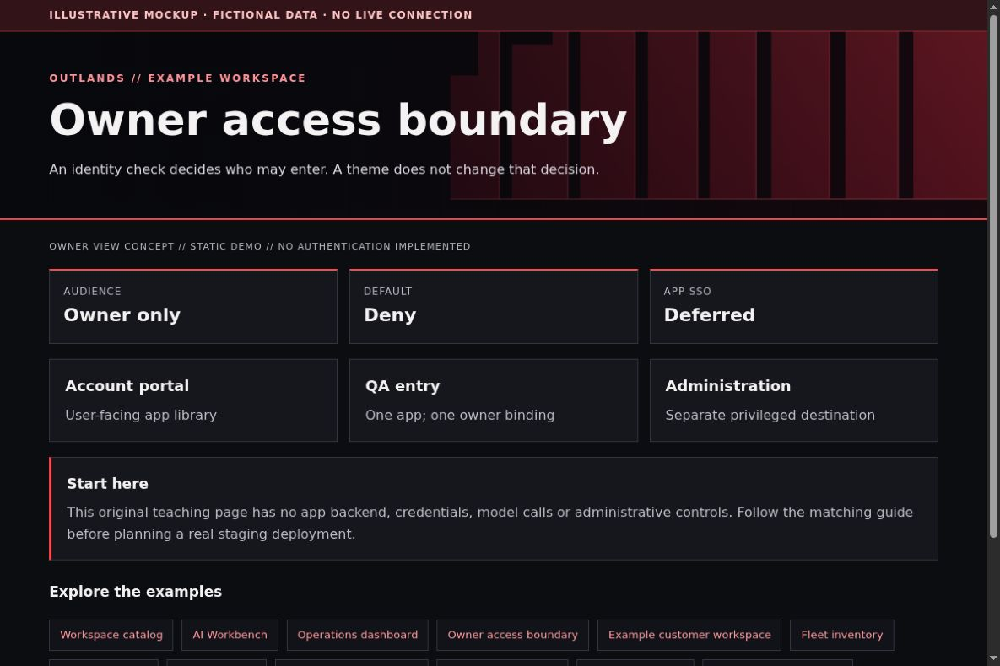

# Authentik: a separate owner-only QA gate

[All app walkthroughs](07-app-walkthroughs.md) · [Architecture](01-architecture.md) · [Access and QA](03-access-and-qa.md)

An identity check decides who may enter. A theme does not change that decision.



This is a screenshot of an original HTML teaching fixture, not a screenshot of the native app or a live deployment. It contains only invented data. Native appearance and supported customization vary by release.

## 1. Try the local example first

You need Python 3.9+ and a browser for this static demo. From the repository root:

```sh
python3 -I -B examples/app-tour/serve_demo.py --port 8766
```

Open `http://127.0.0.1:8766/identity.html`. Stop the server with Ctrl+C when finished. It serves only the fixed demo files on loopback. It has no app APIs, identity sessions, collector, automatic refresh or Docker connection. See the [demo README](../examples/app-tour/README.md).

## 2. Set up a separate staging copy

Install Authentik using the official guide and persist its database, media and required secrets. Save recovery instructions privately. Keep the owner account and administrative interface separate from ordinary app browsing. Do not publish account emails, provider secrets, session cookies or recovery keys.

For Browser QA of one private app, review the proxy-provider modes. A forward-auth setup lets an existing reverse proxy ask Authentik to authorize requests. It does not require replacing the app's own password. Plan one application, provider and explicit owner policy binding, then verify denial for everyone else before linking the entry.

The following is an explanatory policy contract, not an Authentik blueprint or an importable configuration:

```json
{
  "application": "example-fleet-qa",
  "allowed_subject": "fictional-owner-subject",
  "default": "deny",
  "native_app_login": "preserve"
}
```

Use the supported UI/API for your exact release to create objects in a test namespace. Model and serializer names change between releases; do not run database repair scripts from another installation. Treat any identity or route change as a separate approved deployment.

## 3. Match the OUTLANDS design

Apply supported Authentik branding settings and original local assets. Keep the product identity and clear sign-in instructions. Use an unmistakable owner-access denial page with a safe return link. Match the palette without hiding account selection, error messages or MFA controls. A Browser QA gate is a restricted test entrance; shared native app sign-in remains a future project.

The [shared demo CSS](../examples/app-tour/tour.css) styles our own fixtures only. It is not a universal injection stylesheet. Keep dark surfaces, a red wall, visible focus, clear labels and distinct status meanings. Prefer supported native customization; hold an adapter when the installed version has not been reviewed.

## 4. Add a safe Homepage link

In your private Homepage `services.yaml`, add the staging destination only after checking its access boundary. A fictional native Homepage entry looks like this:

```yaml
- Examples:
    - Owner access boundary:
        href: https://identity.example.invalid/
        description: Private staging · verify access separately
```

Replace the address locally. A link does not implement owner-only access. Use a private route, an explicit owner gate where needed, and the app's native login. Keep Grafana on its own password and defer shared app sign-in. No identity or networking state is created by this example.

## 5. Verify before promoting

| Check | Reader's real staging result |
| --- | --- |
| Homepage link opens the intended app and path | NOT RUN |
| Native app version and data location recorded privately | NOT RUN |
| Owner allowed; signed-out and non-owner users denied | NOT RUN |
| Portrait, landscape, keyboard focus and reload usable | NOT RUN |
| No secrets/private data in screenshots or browser errors | NOT RUN |
| Observer route cannot perform app mutations | NOT RUN |
| Prior working release can be restored | NOT RUN |

Check both phone and PC. A browser viewport simulation is useful but does not replace a physical-device check. Do not equate an HTML response, fixture screenshot or source validation with end-to-end app acceptance.

## 6. Troubleshoot and roll back

A redirect loop often means the external URL, proxy headers or cookie scope is wrong. A masked value is not the user's password. Let the owner copy client secrets privately when an approved integration needs them. Roll back only the newly created test objects and route, using recorded object IDs and a checked dependency order. Never remove the existing owner's working login to undo branding.

Keep a timestamped private backup before any approved native theme edit. Change one app at a time. Stop on unexpected behavior instead of repeatedly recreating containers. Use the [operations checklist](05-operations.md) to distinguish a visual rollback from restoring application data.

## Official reference

Use the [official Owner access boundary reference](https://docs.goauthentik.io/add-secure-apps/providers/proxy/) for the exact version you deploy. Checked 2026-10-23. Original fixture/source checks and Browser verification are recorded separately in [VALIDATION.md](../VALIDATION.md). Upstream terms remain separate from this repository's MIT license; see [third-party boundaries](third-party.md).
