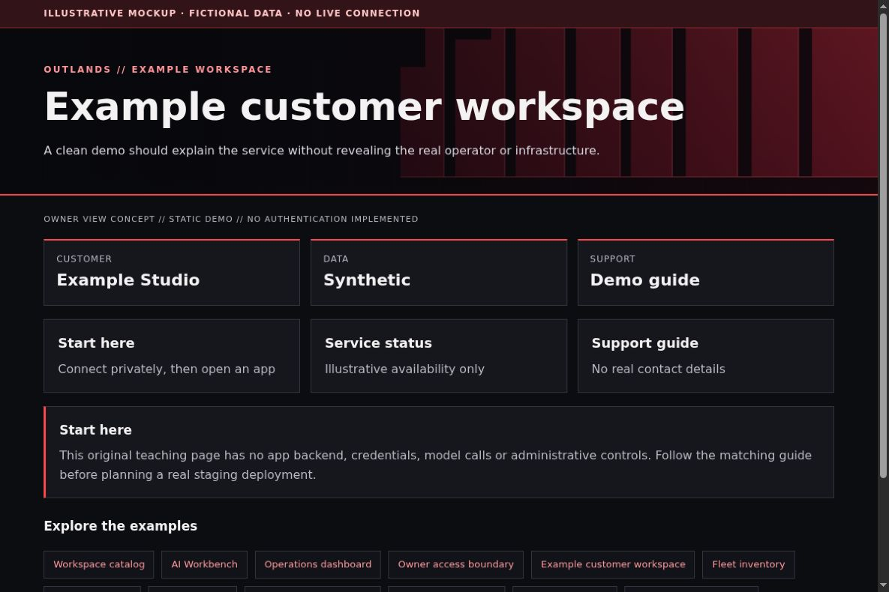

# Client demo and service portal: safe customer-facing examples

[All app walkthroughs](07-app-walkthroughs.md) · [Architecture](01-architecture.md) · [Access and QA](03-access-and-qa.md)

A clean demo should explain the service without revealing the real operator or infrastructure.



This is a screenshot of an original HTML teaching fixture, not a screenshot of the native app or a live deployment. It contains only invented data. Native appearance and supported customization vary by release.

## 1. Try the local example first

You need Python 3.9+ and a browser for this static demo. From the repository root:

```sh
python3 -I -B examples/app-tour/serve_demo.py --port 8766
```

Open `http://127.0.0.1:8766/portals.html`. Stop the server with Ctrl+C when finished. It serves only the fixed demo files on loopback. It has no app APIs, identity sessions, collector, automatic refresh or Docker connection. See the [demo README](../examples/app-tour/README.md).

## 2. Set up a separate staging copy

Build the static fixture first, then decide which functions require a real backend. A client demo can stay static; a customer portal with tickets, billing or account records needs its own authenticated application and authorization model. This repository supplies a clean-room page, not the private implementation of any service portal.

Write a small content contract before coding. It can contain a customer label, links and help text. This example is tutorial data, not an application configuration schema:

```json
{
  "customer": "Example Studio",
  "start_here": "Connect your approved device, then choose an app.",
  "apps": [{"label": "Metrics", "href": "https://metrics.example.invalid/"}],
  "support": "Use your agreed support channel."
}
```

Validate links against an explicit allowlist when accepting editable content. Never place access tokens in URLs. Keep the demo tenant and any screenshots entirely fictional. A customer-specific route must authorize that customer at the backend; hiding other customer tiles is insufficient.

## 3. Match the OUTLANDS design

Use the same red wall, spacing and type hierarchy as Homepage, with an obvious Example Studio label. Provide a short start guide and plain login instructions. Keep support actions visually separate from service navigation. Do not promise monitoring, backup, response times or compliance that the implementation has not demonstrated. Use original marks, not copied customer logos.

The [shared demo CSS](../examples/app-tour/tour.css) styles our own fixtures only. It is not a universal injection stylesheet. Keep dark surfaces, a red wall, visible focus, clear labels and distinct status meanings. Prefer supported native customization; hold an adapter when the installed version has not been reviewed.

## 4. Add a safe Homepage link

In your private Homepage `services.yaml`, add the staging destination only after checking its access boundary. A fictional native Homepage entry looks like this:

```yaml
- Examples:
    - Example customer workspace:
        href: https://portals.example.invalid/
        description: Private staging · verify access separately
```

Replace the address locally. A link does not implement owner-only access. Use a private route, an explicit owner gate where needed, and the app's native login. Keep Grafana on its own password and defer shared app sign-in. No identity or networking state is created by this example.

## 5. Verify before promoting

| Check | Reader's real staging result |
| --- | --- |
| Homepage link opens the intended app and path | NOT RUN |
| Native app version and data location recorded privately | NOT RUN |
| Owner allowed; signed-out and non-owner users denied | NOT RUN |
| Portrait, landscape, keyboard focus and reload usable | NOT RUN |
| No secrets/private data in screenshots or browser errors | NOT RUN |
| Observer route cannot perform app mutations | NOT RUN |
| Prior working release can be restored | NOT RUN |

Check both phone and PC. A browser viewport simulation is useful but does not replace a physical-device check. Do not equate an HTML response, fixture screenshot or source validation with end-to-end app acceptance.

## 6. Troubleshoot and roll back

Check each link on a phone and a PC, including the return path to Homepage. Broken images usually indicate a relative-path/base-path mistake. Restore the previous static release to roll back. For a real portal backend, use its own tested migration/backup process; replacing HTML cannot restore account data.

Keep a timestamped private backup before any approved native theme edit. Change one app at a time. Stop on unexpected behavior instead of repeatedly recreating containers. Use the [operations checklist](05-operations.md) to distinguish a visual rollback from restoring application data.

## Official reference

Use the [official Example customer workspace reference](https://developer.mozilla.org/en-US/docs/Learn_web_development/Core/Structuring_content) for the exact version you deploy. Checked 2026-10-23. Original fixture/source checks and Browser verification are recorded separately in [VALIDATION.md](../VALIDATION.md). Upstream terms remain separate from this repository's MIT license; see [third-party boundaries](third-party.md).
