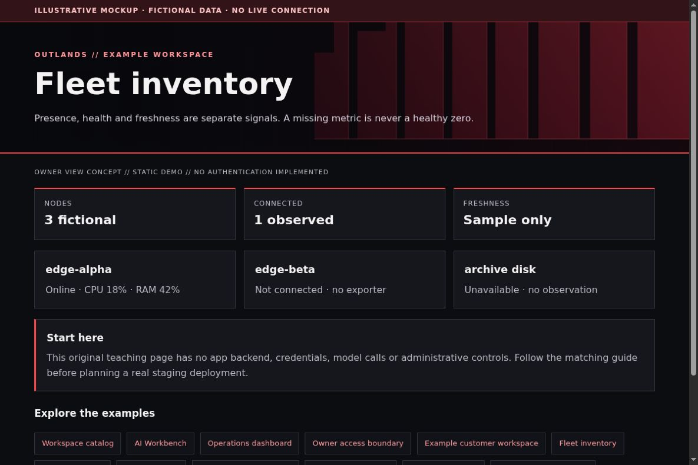

# Fleet Inventory: truthful status and automatic refresh

[All app walkthroughs](07-app-walkthroughs.md) · [Architecture](01-architecture.md) · [Access and QA](03-access-and-qa.md)

Presence, health and freshness are separate signals. A missing metric is never a healthy zero.



This is a screenshot of an original HTML teaching fixture, not a screenshot of the native app or a live deployment. It contains only invented data. Native appearance and supported customization vary by release.

## 1. Try the local example first

You need Python 3.9+ and a browser for this static demo. From the repository root:

```sh
python3 -I -B examples/app-tour/serve_demo.py --port 8766
```

Open `http://127.0.0.1:8766/fleet.html`. Stop the server with Ctrl+C when finished. It serves only the fixed demo files on loopback. It has no app APIs, identity sessions, collector, automatic refresh or Docker connection. See the [demo README](../examples/app-tour/README.md).

## 2. Set up a separate staging copy

Start with a static inventory file and a read-only renderer. Define only the fields the owner needs: a display label, connectivity, last observation and selected health measurements. Do not expose device IDs, user emails, private addresses, tags or a full Tailscale status dump to the browser.

This is a tutorial data contract, not Tailscale output:

```json
{
  "node": "edge-beta",
  "connectivity": "not_connected",
  "observed_at": null,
  "health": {"cpu_percent": null, "ram_percent": null},
  "backup": {"state": "unavailable"}
}
```

Later, run a separate restricted collector that reads inventory metadata and Prometheus measurements, projects this schema, then atomically replaces the public JSON. Use a non-overlapping timer with a bounded timeout and retain the last good file on failure. Put collector credentials outside the web root. Choose a refresh interval appropriate to the data source; a 30-second UI refresh does not make five-minute-old data current.

## 3. Match the OUTLANDS design

Keep node names short and rows responsive. Show the last observation and stale threshold beside health. Use text and shape along with color: Online, Offline, Not connected, Unavailable and Stale need distinct explanations. Keep the backup disk Unavailable until a genuine observation exists. The fixture is static; it does not claim to implement collectors or automatic refresh.

The [shared demo CSS](../examples/app-tour/tour.css) styles our own fixtures only. It is not a universal injection stylesheet. Keep dark surfaces, a red wall, visible focus, clear labels and distinct status meanings. Prefer supported native customization; hold an adapter when the installed version has not been reviewed.

## 4. Add a safe Homepage link

In your private Homepage `services.yaml`, add the staging destination only after checking its access boundary. A fictional native Homepage entry looks like this:

```yaml
- Examples:
    - Fleet inventory:
        href: https://fleet.example.invalid/
        description: Private staging · verify access separately
```

Replace the address locally. A link does not implement owner-only access. Use a private route, an explicit owner gate where needed, and the app's native login. Keep Grafana on its own password and defer shared app sign-in. No identity or networking state is created by this example.

## 5. Verify before promoting

| Check | Reader's real staging result |
| --- | --- |
| Homepage link opens the intended app and path | NOT RUN |
| Native app version and data location recorded privately | NOT RUN |
| Owner allowed; signed-out and non-owner users denied | NOT RUN |
| Portrait, landscape, keyboard focus and reload usable | NOT RUN |
| No secrets/private data in screenshots or browser errors | NOT RUN |
| Observer route cannot perform app mutations | NOT RUN |
| Prior working release can be restored | NOT RUN |

Check both phone and PC. A browser viewport simulation is useful but does not replace a physical-device check. Do not equate an HTML response, fixture screenshot or source validation with end-to-end app acceptance.

## 6. Troubleshoot and roll back

If the inventory is old, inspect the collector's bounded metadata receipt privately, not the browser's identity session. Never add a backend shell endpoint to refresh it. Roll back the renderer and data contract together; preserve the last good data and the collector's prior schedule. Test stale/null states as well as the happy path.

Keep a timestamped private backup before any approved native theme edit. Change one app at a time. Stop on unexpected behavior instead of repeatedly recreating containers. Use the [operations checklist](05-operations.md) to distinguish a visual rollback from restoring application data.

## Official reference

Use the [official Fleet inventory reference](https://tailscale.com/docs/features/tailscale-serve) for the exact version you deploy. Checked 2026-10-23. Original fixture/source checks and Browser verification are recorded separately in [VALIDATION.md](../VALIDATION.md). Upstream terms remain separate from this repository's MIT license; see [third-party boundaries](third-party.md).
