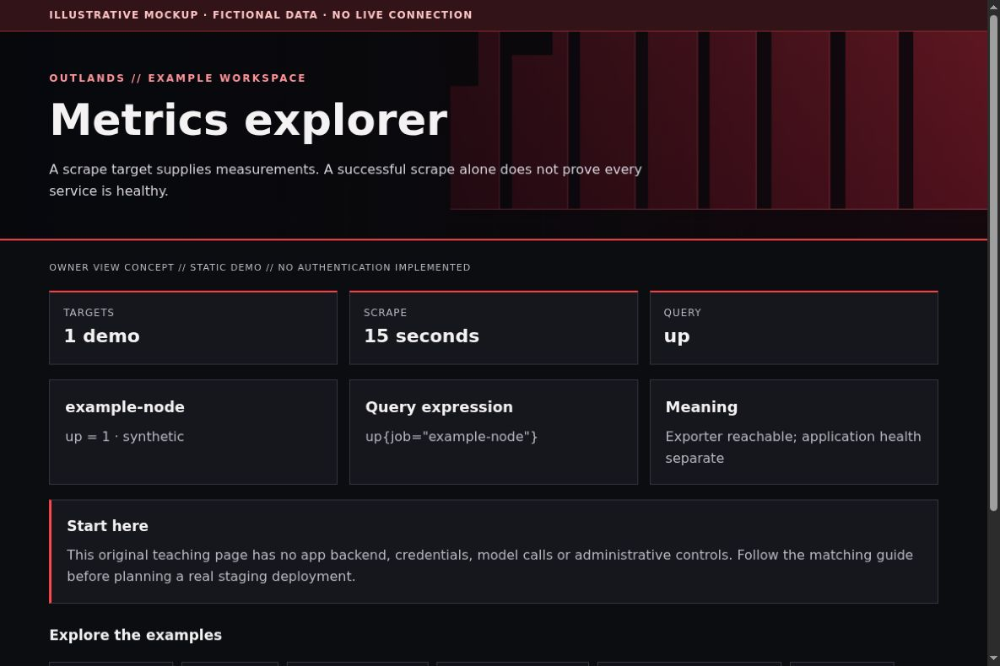

# Prometheus: see where measurements come from

For an installable local-only example with fictional metrics, see the [server-01 synthetic observability module](../modules/observability/synthetic-metrics/README.md). This page remains the product walkthrough.

[All app walkthroughs](07-app-walkthroughs.md) · [Architecture](01-architecture.md) · [Access and QA](03-access-and-qa.md)

A scrape target supplies measurements. A successful scrape alone does not prove every service is healthy.



This is a screenshot of an original HTML teaching fixture, not a screenshot of the native app or a live deployment. It contains only invented data. Native appearance and supported customization vary by release.

## 1. Try the local example first

You need Python 3.9+ and a browser for this static demo. From the repository root:

```sh
python3 -I -B examples/app-tour/serve_demo.py --port 8766
```

Open `http://127.0.0.1:8766/prometheus.html`. Stop the server with Ctrl+C when finished. It serves only the fixed demo files on loopback. It has no app APIs, identity sessions, collector, automatic refresh or Docker connection. See the [demo README](../examples/app-tour/README.md).

## 2. Set up a separate staging copy

Install a selected Prometheus release using its official getting-started guide. Keep its configuration separate from its time-series storage. Use an isolated staging instance and avoid exposing the query interface directly to the public internet. Treat metric labels as potentially sensitive.

A native scrape configuration can start with one exporter. This fictional address will not resolve; replace it only in your private staging copy:

```yaml
global:
  scrape_interval: 15s
scrape_configs:
  - job_name: example-node
    static_configs:
      - targets: ['node.example.invalid:9100']
```

Run `promtool check config prometheus.yml` with the tool version matching your server before a controlled reload. The command checks syntax, not reachability or authorization. Use `up{job="example-node"}` to inspect scrape availability. For CPU, RAM, disk and uptime, first confirm which exporter metrics actually exist and what their units mean. Missing series are unknown, not zero.

## 3. Match the OUTLANDS design

Keep the upstream explorer usable. Use supported appearance options when available; otherwise show the OUTLANDS presentation in Grafana or an original read-only wrapper. Do not promise a universal CSS adapter for every Prometheus release. A proxy overlay needs a release-specific asset and route review, including all query endpoints and any management flags.

The [shared demo CSS](../examples/app-tour/tour.css) styles our own fixtures only. It is not a universal injection stylesheet. Keep dark surfaces, a red wall, visible focus, clear labels and distinct status meanings. Prefer supported native customization; hold an adapter when the installed version has not been reviewed.

## 4. Add a safe Homepage link

In your private Homepage `services.yaml`, add the staging destination only after checking its access boundary. A fictional native Homepage entry looks like this:

```yaml
- Examples:
    - Metrics explorer:
        href: https://prometheus.example.invalid/
        description: Private staging · verify access separately
```

Replace the address locally. A link does not implement owner-only access. Use a private route, an explicit owner gate where needed, and the app's native login. Keep Grafana on its own password and defer shared app sign-in. No identity or networking state is created by this example.

## 5. Verify before promoting

| Check | Reader's real staging result |
| --- | --- |
| Homepage link opens the intended app and path | NOT RUN |
| Native app version and data location recorded privately | NOT RUN |
| Owner allowed; signed-out and non-owner users denied | NOT RUN |
| Portrait, landscape, keyboard focus and reload usable | NOT RUN |
| No secrets/private data in screenshots or browser errors | NOT RUN |
| Observer route cannot perform app mutations | NOT RUN |
| Prior working release can be restored | NOT RUN |

Check both phone and PC. A browser viewport simulation is useful but does not replace a physical-device check. Do not equate an HTML response, fixture screenshot or source validation with end-to-end app acceptance.

## 6. Troubleshoot and roll back

If `up` is zero, check target reachability, scrape path and exporter status. If no series exists, check target discovery and label filters. Restore the prior config and validate it before reload; do not delete the time-series directory to undo a theme. Deny lifecycle/admin endpoints in an observer route even if the UI normally never calls them.

Keep a timestamped private backup before any approved native theme edit. Change one app at a time. Stop on unexpected behavior instead of repeatedly recreating containers. Use the [operations checklist](05-operations.md) to distinguish a visual rollback from restoring application data.

## Official reference

Use the [official Metrics explorer reference](https://prometheus.io/docs/prometheus/latest/getting_started/) for the exact version you deploy. Checked 2026-10-23. Original fixture/source checks and Browser verification are recorded separately in [VALIDATION.md](../VALIDATION.md). Upstream terms remain separate from this repository's MIT license; see [third-party boundaries](third-party.md).
