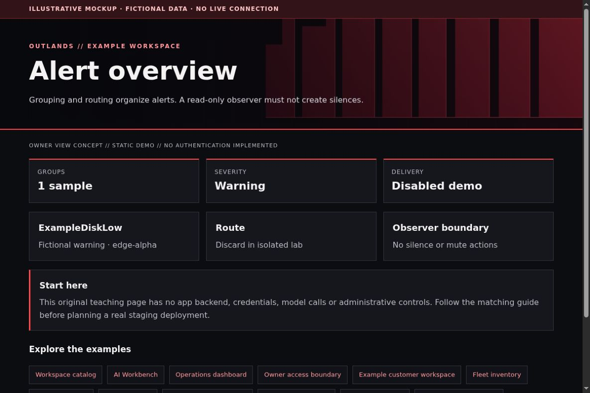

# Alertmanager: understand alerts without changing them

[All app walkthroughs](07-app-walkthroughs.md) · [Architecture](01-architecture.md) · [Access and QA](03-access-and-qa.md)

Grouping and routing organize alerts. A read-only observer must not create silences.



This is a screenshot of an original HTML teaching fixture, not a screenshot of the native app or a live deployment. It contains only invented data. Native appearance and supported customization vary by release.

## 1. Try the local example first

You need Python 3.9+ and a browser for this static demo. From the repository root:

```sh
python3 -I -B examples/app-tour/serve_demo.py --port 8766
```

Open `http://127.0.0.1:8766/alertmanager.html`. Stop the server with Ctrl+C when finished. It serves only the fixed demo files on loopback. It has no app APIs, identity sessions, collector, automatic refresh or Docker connection. See the [demo README](../examples/app-tour/README.md).

## 2. Set up a separate staging copy

Use the upstream installation guide for a selected Alertmanager release. Keep its config and persistent state separate. Start in an isolated lab with no email, webhook or messaging receiver credentials. Alertmanager groups alerts and chooses notification receivers; Prometheus rules usually decide when an alert fires.

This native configuration intentionally discards notifications in a lab:

```yaml
route:
  receiver: discard-lab
  group_by: ['alertname']
receivers:
  - name: discard-lab
```

Do not copy it over production routing: that would suppress notifications. Validate a lab copy with `amtool check-config alertmanager.yml` using the matching release. To test routing later, use a deliberately approved test receiver and alert. Record whether a message was actually delivered; valid YAML alone does not prove delivery.

## 3. Match the OUTLANDS design

Keep warning and critical meanings distinct from the red brand accent. Show source, age and affected service. For owner-only read-only QA, permit only reviewed observation operations. Silence creation/expiry and routing changes are mutations, even if initiated from a familiar interface. Keep those outside the observer route. Use a branded static summary if the native UI cannot safely be styled.

The [shared demo CSS](../examples/app-tour/tour.css) styles our own fixtures only. It is not a universal injection stylesheet. Keep dark surfaces, a red wall, visible focus, clear labels and distinct status meanings. Prefer supported native customization; hold an adapter when the installed version has not been reviewed.

## 4. Add a safe Homepage link

In your private Homepage `services.yaml`, add the staging destination only after checking its access boundary. A fictional native Homepage entry looks like this:

```yaml
- Examples:
    - Alert overview:
        href: https://alertmanager.example.invalid/
        description: Private staging · verify access separately
```

Replace the address locally. A link does not implement owner-only access. Use a private route, an explicit owner gate where needed, and the app's native login. Keep Grafana on its own password and defer shared app sign-in. No identity or networking state is created by this example.

## 5. Verify before promoting

| Check | Reader's real staging result |
| --- | --- |
| Homepage link opens the intended app and path | NOT RUN |
| Native app version and data location recorded privately | NOT RUN |
| Owner allowed; signed-out and non-owner users denied | NOT RUN |
| Portrait, landscape, keyboard focus and reload usable | NOT RUN |
| No secrets/private data in screenshots or browser errors | NOT RUN |
| Observer route cannot perform app mutations | NOT RUN |
| Prior working release can be restored | NOT RUN |

Check both phone and PC. A browser viewport simulation is useful but does not replace a physical-device check. Do not equate an HTML response, fixture screenshot or source validation with end-to-end app acceptance.

## 6. Troubleshoot and roll back

If no notification arrives, check routing and inhibition/silence state before editing the theme. Never click Silence during a read-only review. Restore the prior routing file for a config rollback and retain current alert state unless a separate recovery plan says otherwise. Test recipient delivery only with explicit approval.

Keep a timestamped private backup before any approved native theme edit. Change one app at a time. Stop on unexpected behavior instead of repeatedly recreating containers. Use the [operations checklist](05-operations.md) to distinguish a visual rollback from restoring application data.

## Official reference

Use the [official Alert overview reference](https://prometheus.io/docs/alerting/latest/configuration/) for the exact version you deploy. Checked 2026-10-23. Original fixture/source checks and Browser verification are recorded separately in [VALIDATION.md](../VALIDATION.md). Upstream terms remain separate from this repository's MIT license; see [third-party boundaries](third-party.md).
