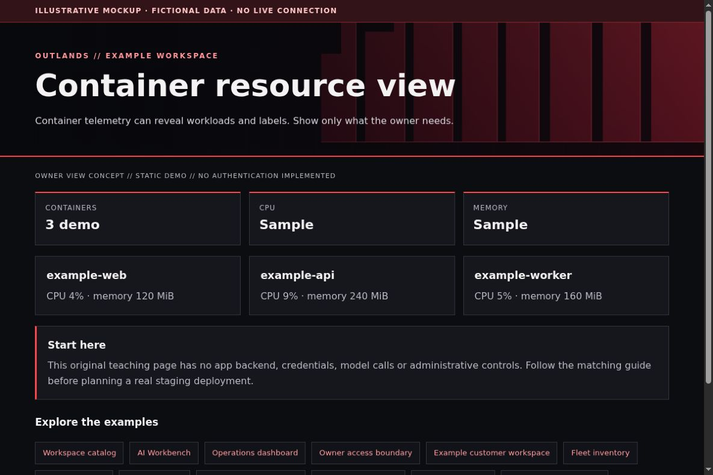

# cAdvisor: container measurements with a small exposure boundary

[All app walkthroughs](07-app-walkthroughs.md) · [Architecture](01-architecture.md) · [Access and QA](03-access-and-qa.md)

Container telemetry can reveal workloads and labels. Show only what the owner needs.



This is a screenshot of an original HTML teaching fixture, not a screenshot of the native app or a live deployment. It contains only invented data. Native appearance and supported customization vary by release.

## 1. Try the local example first

You need Python 3.9+ and a browser for this static demo. From the repository root:

```sh
python3 -I -B examples/app-tour/serve_demo.py --port 8766
```

Open `http://127.0.0.1:8766/cadvisor.html`. Stop the server with Ctrl+C when finished. It serves only the fixed demo files on loopback. It has no app APIs, identity sessions, collector, automatic refresh or Docker connection. See the [demo README](../examples/app-tour/README.md).

## 2. Set up a separate staging copy

Read the cAdvisor instructions for your kernel, container runtime and release. It observes container resource use and can expose Prometheus metrics. Its host visibility requirements are substantial; do not copy privileged flags or host filesystem mounts from an unrelated server simply to get a themed page.

Keep the exporter reachable only by the monitoring collector on a reviewed internal network. A Prometheus scrape job, not a cAdvisor service definition, can look like this:

```yaml
scrape_configs:
  - job_name: example-containers
    static_configs:
      - targets: ['cadvisor.example.invalid:8080']
```

The example cannot contact a real host. Review label/cardinality settings for your release before enabling a large fleet. Do not publish container IDs, image registry credentials, private mount paths or complete label sets in screenshots.

## 3. Match the OUTLANDS design

Prefer Grafana panels over replacing cAdvisor's native bundles. Reuse the same chart units and restrained colors across host and container views. Native UI appearance is release-specific; the screenshot here is an original resource-card mockup, not an upstream cAdvisor screenshot. A read-only browser route does not make the collector's host mounts harmless.

The [shared demo CSS](../examples/app-tour/tour.css) styles our own fixtures only. It is not a universal injection stylesheet. Keep dark surfaces, a red wall, visible focus, clear labels and distinct status meanings. Prefer supported native customization; hold an adapter when the installed version has not been reviewed.

## 4. Add a safe Homepage link

In your private Homepage `services.yaml`, add the staging destination only after checking its access boundary. A fictional native Homepage entry looks like this:

```yaml
- Examples:
    - Container resource view:
        href: https://cadvisor.example.invalid/
        description: Private staging · verify access separately
```

Replace the address locally. A link does not implement owner-only access. Use a private route, an explicit owner gate where needed, and the app's native login. Keep Grafana on its own password and defer shared app sign-in. No identity or networking state is created by this example.

## 5. Verify before promoting

| Check | Reader's real staging result |
| --- | --- |
| Homepage link opens the intended app and path | NOT RUN |
| Native app version and data location recorded privately | NOT RUN |
| Owner allowed; signed-out and non-owner users denied | NOT RUN |
| Portrait, landscape, keyboard focus and reload usable | NOT RUN |
| No secrets/private data in screenshots or browser errors | NOT RUN |
| Observer route cannot perform app mutations | NOT RUN |
| Prior working release can be restored | NOT RUN |

Check both phone and PC. A browser viewport simulation is useful but does not replace a physical-device check. Do not equate an HTML response, fixture screenshot or source validation with end-to-end app acceptance.

## 6. Troubleshoot and roll back

If metrics disappear after a runtime update, check cAdvisor/runtime compatibility and collector reachability. Do not broaden host permissions as a theme fix. Roll back the presentation independently of exporter config. For exporter rollback, restore the pinned image and reviewed mounts without touching application containers or their data.

Keep a timestamped private backup before any approved native theme edit. Change one app at a time. Stop on unexpected behavior instead of repeatedly recreating containers. Use the [operations checklist](05-operations.md) to distinguish a visual rollback from restoring application data.

## Official reference

Use the [official Container resource view reference](https://github.com/google/cadvisor/blob/master/docs/storage/prometheus.md) for the exact version you deploy. Checked 2026-10-23. Original fixture/source checks and Browser verification are recorded separately in [VALIDATION.md](../VALIDATION.md). Upstream terms remain separate from this repository's MIT license; see [third-party boundaries](third-party.md).
