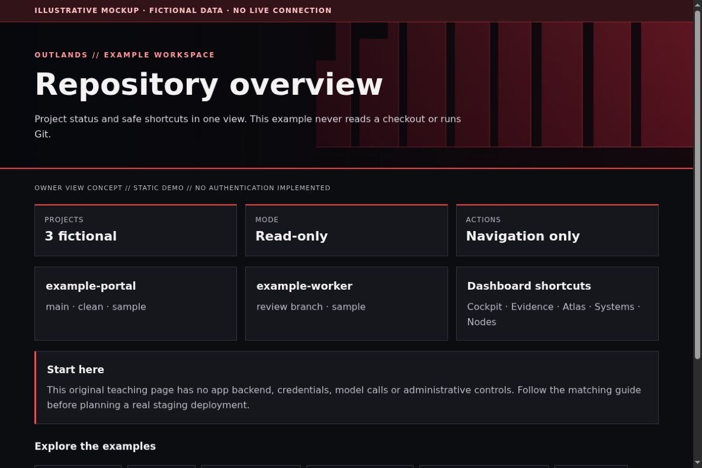

# Git Manager: a read-only repository dashboard

[All app walkthroughs](07-app-walkthroughs.md) · [Architecture](01-architecture.md) · [Access and QA](03-access-and-qa.md)

Project status and safe shortcuts in one view. This example never reads a checkout or runs Git.



This is a screenshot of an original HTML teaching fixture, not a screenshot of the native app or a live deployment. It contains only invented data. Native appearance and supported customization vary by release.

## 1. Try the local example first

You need Python 3.9+ and a browser for this static demo. From the repository root:

```sh
python3 -I -B examples/app-tour/serve_demo.py --port 8766
```

Open `http://127.0.0.1:8766/git-manager.html`. Stop the server with Ctrl+C when finished. It serves only the fixed demo files on loopback. It has no app APIs, identity sessions, collector, automatic refresh or Docker connection. See the [demo README](../examples/app-tour/README.md).

## 2. Set up a separate staging copy

Build a small original view rather than publishing an existing private manager. Define a fixed registry of approved repository display names and locations in a private collector config. The browser should receive only projected status data, not filesystem paths, remotes with credentials or file contents.

This is a sample browser data contract, not Git configuration:

```json
{
  "project": "example-portal",
  "branch": "main",
  "worktree": "clean",
  "observed_at": "2030-01-01T12:00:00Z",
  "shortcuts": [{"label": "Cockpit", "href": "https://dash.example.invalid/"}]
}
```

A future collector can use `git --no-optional-locks status --porcelain=v1` to avoid optional index refresh writes, with read-only filesystem access as an additional boundary. Use inspection against an explicit registry with fixed arguments, bounded output and a timeout. Do not accept repository paths or Git commands from HTTP parameters. A `git status` result can contain private filenames, so project only an aggregate state. Treat branch and project labels as untrusted text and escape them in HTML.

## 3. Match the OUTLANDS design

Use cards for projects and a clear navigation-only label. Add five clearly named dashboard shortcuts and stable absolute HTTPS destinations in your private copy. Use the same banner and buttons as Homepage. Do not add Pull, Commit, Delete or shell actions to an observer interface. There is no backend Git execution in this public fixture.

The [shared demo CSS](../examples/app-tour/tour.css) styles our own fixtures only. It is not a universal injection stylesheet. Keep dark surfaces, a red wall, visible focus, clear labels and distinct status meanings. Prefer supported native customization; hold an adapter when the installed version has not been reviewed.

## 4. Add a safe Homepage link

In your private Homepage `services.yaml`, add the staging destination only after checking its access boundary. A fictional native Homepage entry looks like this:

```yaml
- Examples:
    - Repository overview:
        href: https://git-manager.example.invalid/
        description: Private staging · verify access separately
```

Replace the address locally. A link does not implement owner-only access. Use a private route, an explicit owner gate where needed, and the app's native login. Keep Grafana on its own password and defer shared app sign-in. No identity or networking state is created by this example.

## 5. Verify before promoting

| Check | Reader's real staging result |
| --- | --- |
| Homepage link opens the intended app and path | NOT RUN |
| Native app version and data location recorded privately | NOT RUN |
| Owner allowed; signed-out and non-owner users denied | NOT RUN |
| Portrait, landscape, keyboard focus and reload usable | NOT RUN |
| No secrets/private data in screenshots or browser errors | NOT RUN |
| Observer route cannot perform app mutations | NOT RUN |
| Prior working release can be restored | NOT RUN |

Check both phone and PC. A browser viewport simulation is useful but does not replace a physical-device check. Do not equate an HTML response, fixture screenshot or source validation with end-to-end app acceptance.

## 6. Troubleshoot and roll back

If shortcuts work on the server but fail on a phone, check for loopback URLs; a phone's loopback points to the phone. A missing status may be an unavailable collector, not a dirty repository. Roll back the static frontend and schema together. Never reset a repository to repair a dashboard.

Keep a timestamped private backup before any approved native theme edit. Change one app at a time. Stop on unexpected behavior instead of repeatedly recreating containers. Use the [operations checklist](05-operations.md) to distinguish a visual rollback from restoring application data.

## Official reference

Use the [official Repository overview reference](https://git-scm.com/docs/git-status) for the exact version you deploy. Checked 2026-10-23. Original fixture/source checks and Browser verification are recorded separately in [VALIDATION.md](../VALIDATION.md). Upstream terms remain separate from this repository's MIT license; see [third-party boundaries](third-party.md).
