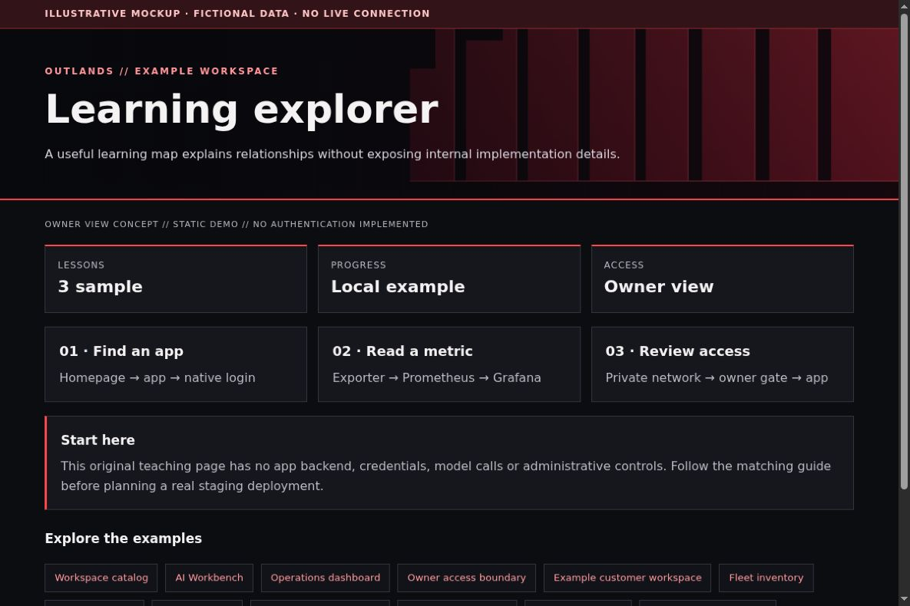

# Learning Explorer: turn your system into a guided map

[All app walkthroughs](07-app-walkthroughs.md) · [Architecture](01-architecture.md) · [Access and QA](03-access-and-qa.md)

A useful learning map explains relationships without exposing internal implementation details.



This is a screenshot of an original HTML teaching fixture, not a screenshot of the native app or a live deployment. It contains only invented data. Native appearance and supported customization vary by release.

## 1. Try the local example first

You need Python 3.9+ and a browser for this static demo. From the repository root:

```sh
python3 -I -B examples/app-tour/serve_demo.py --port 8766
```

Open `http://127.0.0.1:8766/learning.html`. Stop the server with Ctrl+C when finished. It serves only the fixed demo files on loopback. It has no app APIs, identity sessions, collector, automatic refresh or Docker connection. See the [demo README](../examples/app-tour/README.md).

## 2. Set up a separate staging copy

Start with a static map of a fictional system. For each lesson, write the question, the system component and one safe exercise. Keep production infrastructure diagrams and internal runbooks out of the public fixture. This is an original educational sample, not a distribution of a private learning application.

A sample lesson record can look like this:

```json
{
  "lesson": "read-a-metric",
  "title": "Where does CPU usage come from?",
  "steps": ["Find the exporter", "Check a scrape", "Read the dashboard"],
  "exercise": "Explain the difference between missing and zero."
}
```

Render lesson text as escaped content. If you later store progress, define user ownership and retention before adding a database. Do not let a lesson execute arbitrary shell snippets or read local documents. Link to public vendor references rather than copying private manuals.

## 3. Match the OUTLANDS design

Use numbered modules, short paragraphs and labeled links. Keep keyboard focus visible and provide text alternatives to the visual map. A red wall can frame the page without sitting behind dense lesson text. On mobile, stack relationships vertically; do not force users to pan a wide graph to read the instructions.

The [shared demo CSS](../examples/app-tour/tour.css) styles our own fixtures only. It is not a universal injection stylesheet. Keep dark surfaces, a red wall, visible focus, clear labels and distinct status meanings. Prefer supported native customization; hold an adapter when the installed version has not been reviewed.

## 4. Add a safe Homepage link

In your private Homepage `services.yaml`, add the staging destination only after checking its access boundary. A fictional native Homepage entry looks like this:

```yaml
- Examples:
    - Learning explorer:
        href: https://learning.example.invalid/
        description: Private staging · verify access separately
```

Replace the address locally. A link does not implement owner-only access. Use a private route, an explicit owner gate where needed, and the app's native login. Keep Grafana on its own password and defer shared app sign-in. No identity or networking state is created by this example.

## 5. Verify before promoting

| Check | Reader's real staging result |
| --- | --- |
| Homepage link opens the intended app and path | NOT RUN |
| Native app version and data location recorded privately | NOT RUN |
| Owner allowed; signed-out and non-owner users denied | NOT RUN |
| Portrait, landscape, keyboard focus and reload usable | NOT RUN |
| No secrets/private data in screenshots or browser errors | NOT RUN |
| Observer route cannot perform app mutations | NOT RUN |
| Prior working release can be restored | NOT RUN |

Check both phone and PC. A browser viewport simulation is useful but does not replace a physical-device check. Do not equate an HTML response, fixture screenshot or source validation with end-to-end app acceptance.

## 6. Troubleshoot and roll back

If a lesson destination is missing, mark it unavailable with a safe return path. Avoid inaccessible icon-only hotspots. Roll back the static lesson bundle independently of any progress database. Test a new lesson as a beginner: every term should be introduced before it is used.

Keep a timestamped private backup before any approved native theme edit. Change one app at a time. Stop on unexpected behavior instead of repeatedly recreating containers. Use the [operations checklist](05-operations.md) to distinguish a visual rollback from restoring application data.

## Official reference

Use the [official Learning explorer reference](https://developer.mozilla.org/en-US/docs/Learn_web_development/Core/Accessibility) for the exact version you deploy. Checked 2026-10-23. Original fixture/source checks and Browser verification are recorded separately in [VALIDATION.md](../VALIDATION.md). Upstream terms remain separate from this repository's MIT license; see [third-party boundaries](third-party.md).
