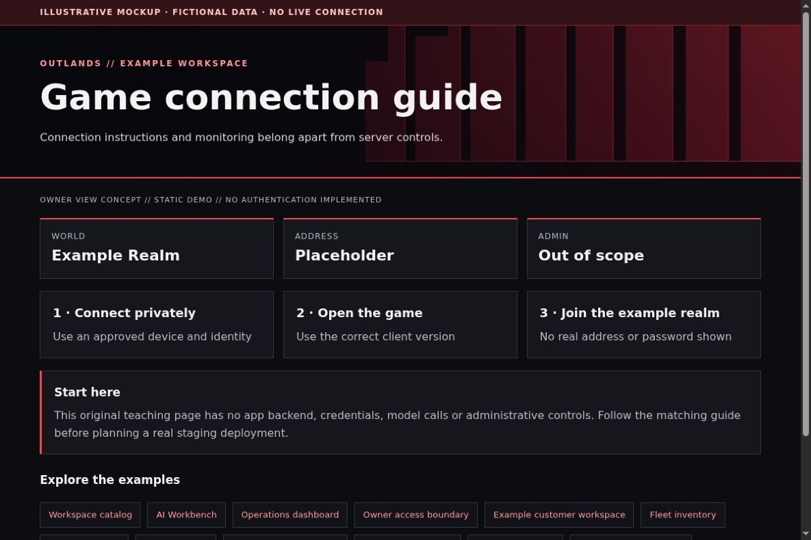

# Game connection guides: help players without exposing administration

[All app walkthroughs](07-app-walkthroughs.md) · [Architecture](01-architecture.md) · [Access and QA](03-access-and-qa.md)

Connection instructions and monitoring belong apart from server controls.



This is a screenshot of an original HTML teaching fixture, not a screenshot of the native app or a live deployment. It contains only invented data. Native appearance and supported customization vary by release.

## 1. Try the local example first

You need Python 3.9+ and a browser for this static demo. From the repository root:

```sh
python3 -I -B examples/app-tour/serve_demo.py --port 8766
```

Open `http://127.0.0.1:8766/game-connections.html`. Stop the server with Ctrl+C when finished. It serves only the fixed demo files on loopback. It has no app APIs, identity sessions, collector, automatic refresh or Docker connection. See the [demo README](../examples/app-tour/README.md).

## 2. Set up a separate staging copy

Create an instruction page before adding server controls. State the game/client version, approved network path and how the owner privately supplies connection details. Do not publish join passwords, player identities, real server addresses or admin endpoints. Product-specific server licensing and client setup remain the reader's responsibility.

The following is fictional guide content, not a game server configuration:

```json
{
  "world": "Example Realm",
  "address": "game.example.invalid",
  "client_version": "Confirm with the operator",
  "credentials": "Provided privately by the operator"
}
```

A Tailscale Serve HTTPS page can host instructions; that does not automatically proxy a game's TCP/UDP traffic. Review each game's actual protocols and your network policy separately. Keep monitoring dashboards under Grafana's native login. Pelican/Game Server Control installation and theming are intentionally outside this walkthrough.

## 3. Match the OUTLANDS design

Use original environment art or the repository's geometric wall. Keep the connection steps readable and include a back-to-Homepage link. Show service availability separately from player counts and capacity. Do not use game logos, screenshots or music without reviewing their terms. The sample has no game artwork or executable server controls.

The [shared demo CSS](../examples/app-tour/tour.css) styles our own fixtures only. It is not a universal injection stylesheet. Keep dark surfaces, a red wall, visible focus, clear labels and distinct status meanings. Prefer supported native customization; hold an adapter when the installed version has not been reviewed.

## 4. Add a safe Homepage link

In your private Homepage `services.yaml`, add the staging destination only after checking its access boundary. A fictional native Homepage entry looks like this:

```yaml
- Examples:
    - Game connection guide:
        href: https://game-connections.example.invalid/
        description: Private staging · verify access separately
```

Replace the address locally. A link does not implement owner-only access. Use a private route, an explicit owner gate where needed, and the app's native login. Keep Grafana on its own password and defer shared app sign-in. No identity or networking state is created by this example.

## 5. Verify before promoting

| Check | Reader's real staging result |
| --- | --- |
| Homepage link opens the intended app and path | NOT RUN |
| Native app version and data location recorded privately | NOT RUN |
| Owner allowed; signed-out and non-owner users denied | NOT RUN |
| Portrait, landscape, keyboard focus and reload usable | NOT RUN |
| No secrets/private data in screenshots or browser errors | NOT RUN |
| Observer route cannot perform app mutations | NOT RUN |
| Prior working release can be restored | NOT RUN |

Check both phone and PC. A browser viewport simulation is useful but does not replace a physical-device check. Do not equate an HTML response, fixture screenshot or source validation with end-to-end app acceptance.

## 6. Troubleshoot and roll back

If the guide opens but the game cannot connect, check client version, network authorization and the game's actual service path. An HTTPS page loading is not a game-connectivity test. Roll back the guide's static release without restarting a game server. Report control-panel testing as not run.

Keep a timestamped private backup before any approved native theme edit. Change one app at a time. Stop on unexpected behavior instead of repeatedly recreating containers. Use the [operations checklist](05-operations.md) to distinguish a visual rollback from restoring application data.

## Official reference

Use the [official Game connection guide reference](https://tailscale.com/docs/features/tailscale-serve) for the exact version you deploy. Checked 2026-10-23. Original fixture/source checks and Browser verification are recorded separately in [VALIDATION.md](../VALIDATION.md). Upstream terms remain separate from this repository's MIT license; see [third-party boundaries](third-party.md).
