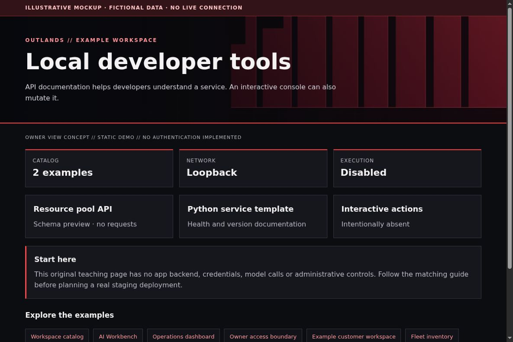

# Local API tools: document without granting execution

[All app walkthroughs](07-app-walkthroughs.md) · [Architecture](01-architecture.md) · [Access and QA](03-access-and-qa.md)

API documentation helps developers understand a service. An interactive console can also mutate it.



This is a screenshot of an original HTML teaching fixture, not a screenshot of the native app or a live deployment. It contains only invented data. Native appearance and supported customization vary by release.

## 1. Try the local example first

You need Python 3.9+ and a browser for this static demo. From the repository root:

```sh
python3 -I -B examples/app-tour/serve_demo.py --port 8766
```

Open `http://127.0.0.1:8766/local-tools.html`. Stop the server with Ctrl+C when finished. It serves only the fixed demo files on loopback. It has no app APIs, identity sessions, collector, automatic refresh or Docker connection. See the [demo README](../examples/app-tour/README.md).

## 2. Set up a separate staging copy

Start with the service's public schema and a static documentation page. A resource-pool API and a Python-service template can share a consistent navigation style without sharing credentials or execution privileges. Keep local-only tools labeled as local; a loopback URL on a phone targets the phone.

This minimal OpenAPI example documents a read-only health response. It is an example contract, not a running server:

```yaml
openapi: 3.0.3
info:
  title: Example Service
  version: 0.1.0
paths:
  /health:
    get:
      responses:
        '200':
          description: Service answered; dependencies checked separately
```

Use a selected OpenAPI renderer in an isolated development environment. Review or disable its interactive request feature for an observer route. GET-only documentation does not prove that all underlying APIs are read-only. Do not expose a development debugger or local shell as a convenience endpoint.

## 3. Match the OUTLANDS design

Use a shared header, syntax colors with adequate contrast and a clear environment label. Keep request examples fictional. For a branded local service baseline, separate static documentation from the application and its credentials. The fixture has no Try it out control, fetch logic or backend connection.

The [shared demo CSS](../examples/app-tour/tour.css) styles our own fixtures only. It is not a universal injection stylesheet. Keep dark surfaces, a red wall, visible focus, clear labels and distinct status meanings. Prefer supported native customization; hold an adapter when the installed version has not been reviewed.

## 4. Add a safe Homepage link

In your private Homepage `services.yaml`, add the staging destination only after checking its access boundary. A fictional native Homepage entry looks like this:

```yaml
- Examples:
    - Local developer tools:
        href: https://local-tools.example.invalid/
        description: Private staging · verify access separately
```

Replace the address locally. A link does not implement owner-only access. Use a private route, an explicit owner gate where needed, and the app's native login. Keep Grafana on its own password and defer shared app sign-in. No identity or networking state is created by this example.

## 5. Verify before promoting

| Check | Reader's real staging result |
| --- | --- |
| Homepage link opens the intended app and path | NOT RUN |
| Native app version and data location recorded privately | NOT RUN |
| Owner allowed; signed-out and non-owner users denied | NOT RUN |
| Portrait, landscape, keyboard focus and reload usable | NOT RUN |
| No secrets/private data in screenshots or browser errors | NOT RUN |
| Observer route cannot perform app mutations | NOT RUN |
| Prior working release can be restored | NOT RUN |

Check both phone and PC. A browser viewport simulation is useful but does not replace a physical-device check. Do not equate an HTML response, fixture screenshot or source validation with end-to-end app acceptance.

## 6. Troubleshoot and roll back

If documentation loads but an API fails, distinguish static delivery from runtime health and authorization. Keep raw stack traces and environment values private. Roll back the documentation bundle separately; an API version or database migration needs its own compatibility and recovery plan.

Keep a timestamped private backup before any approved native theme edit. Change one app at a time. Stop on unexpected behavior instead of repeatedly recreating containers. Use the [operations checklist](05-operations.md) to distinguish a visual rollback from restoring application data.

## Official reference

Use the [official Local developer tools reference](https://spec.openapis.org/oas/v3.0.3.html) for the exact version you deploy. Checked 2026-10-23. Original fixture/source checks and Browser verification are recorded separately in [VALIDATION.md](../VALIDATION.md). Upstream terms remain separate from this repository's MIT license; see [third-party boundaries](third-party.md).
