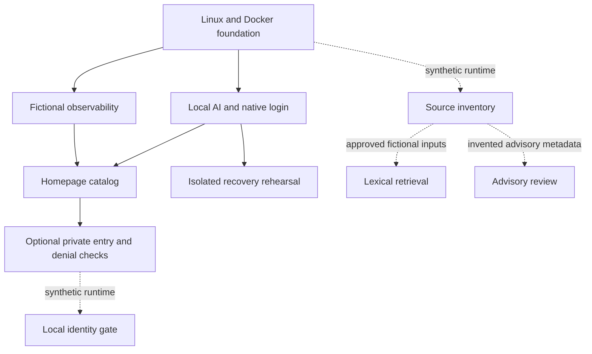

# The systems blueprint

OUTLANDS is a modular private workspace: a host foundation, independently
protected applications, a catalog, observability, and a repeatable engineering
method. This public map explains roles and interfaces using fictional examples.
It is not a real host inventory. `server-01` is the published reference role.

Arrows describe the example's learning order. They do not create network routes,
shared credentials, an ingestion pipeline, or an installation dependency.

## Systems and public coverage

| Role / planner ID | What the repository supplies | Acceptance boundary |
| --- | --- | --- |
| Host foundation / `foundation` | [Linux/Docker foundation](../modules/foundation/docker-host/README.md), blank configuration and isolated smoke fixture | Reader selects and installs supported software; daemon privileges and recovery require separate review. |
| Local AI / `ai` | [Ollama + Open WebUI](../modules/ai/ollama-open-webui/README.md), CPU default, optional GPU overlay, inference helper | Reader chooses models and resources privately; hosted inference does not qualify reader hardware or data handling. |
| Observability / `observability` | [Fictional metrics](../modules/observability/synthetic-metrics/README.md) and [optional host-health examples](../modules/observability/host-health/README.md) | Synthetic freshness is distinct from live collection, alert delivery, coverage and retention. |
| Catalog / `catalog` | [Homepage module](../modules/catalog/homepage/README.md) with invented links | Every destination retains its own authentication and denial checks. |
| Private entry / `private-entry` | [Route trial and access worksheet](../modules/access/private-entry/README.md) | Local success does not establish remote policy or denied-device behavior. |
| Identity / `identity` | [Working gate and retrieval session integration](../modules/reference-systems/IDENTITY.md) | Public fictional accounts and loopback HTTP only; real IdP/SSO, MFA and TLS remain separate. |
| Recovery / `recovery` | [Disposable volume archive/restore rehearsal](../staging/server-01/README.md) | Rehearsal coverage only; no real backup destination, archive or restoration result is published. |
| Source inventory / `source-inventory` | [Working bounded scanner](../modules/reference-systems/INVENTORY.md) | Explicit private-root opt-in, aggregate private reports; no discovery or authorship inference. |
| Retrieval / `retrieval` | [Working admitted lexical engine](../modules/reference-systems/RETRIEVAL.md) | Fictional corpus, role filtering and in-memory deletion; no real connector, embeddings or generation. |
| Security review / `security-review` | [Working offline advisory matcher](../modules/reference-systems/ADVISORIES.md) | Invented products and ranges only; no target testing, live feed or remediation. |

`REFERENCE` in the [planner fixture](../tools/workspace-plan/systems.example.json)
means an inspectable guide or example exists. `REHEARSAL` means a disposable
method exists. `SYNTHETIC_RUNTIME` means working code with invented fixtures; `DESIGN_ONLY` is
reserved for future unimplemented roles. None of these labels means a real
installation is deployed or accepted. Every planner acceptance gate stays NOT_RUN.

## Working systems and remaining integration boundaries

The [runnable systems bundle](../modules/reference-systems/README.md) contains
setup and rollback guides, original code and synthetic fixtures for all four
formerly design-only roles. Run its combined demo without network activity, or
start its explicit loopback identity server to exercise session-to-retrieval
filtering. Its tests cover allowed and denied behavior over actual local HTTP.

**Source inventory** counts saved files under one explicit root, separates
code/configuration/prose, excludes named generated/vendor directories and refuses
links, special files, changed inputs and bound violations. Default use scans
only the fictional tree. A separate reader-private scan writes aggregates into
a new 0600 report; it prints no real counts, filenames or root paths. Policy
coverage remains partial. Counts establish neither authorship nor rights.

**Retrieval** checks admission and synthetic-rights declarations, creates bounded
chunks, filters by a trusted role before ranking, returns source IDs and untrusted
extracts, and supports owner-only in-memory deletion. The identity server supplies
the role from its session. No real corpus, connector, model or embedding store is
enabled; persistent deletion across process restarts is not implemented.

**Identity** supplies local fictional password verification, expiring opaque
sessions, owner/reader authorization, rotation, CSRF-protected logout and real
retrieval integration. Its accounts are public fixtures. It must stay isolated
on loopback HTTP; it is not a production IdP, native SSO or a TLS/MFA deployment.
Keep native account recovery separate from any future provider integration.

**Security review** retains invented source URLs and observation times while
joining exact product IDs to bounded numeric version ranges. Candidates remain
unconfirmed and no-match does not mean safe. There is no live feed, installed
asset discovery, target testing or automated repair. Private adapters need their
own provenance, version semantics, completeness and failure review.

Use the [offline planner](../tools/workspace-plan/README.md) to inspect an ordered
profile, then follow the [setup guide](26-workspace-setup.md). Integrate new roles
one at a time using the [module contract](../modules/README.md), fictional fixtures,
bounded checks and an explicit statement of what remains untested.
