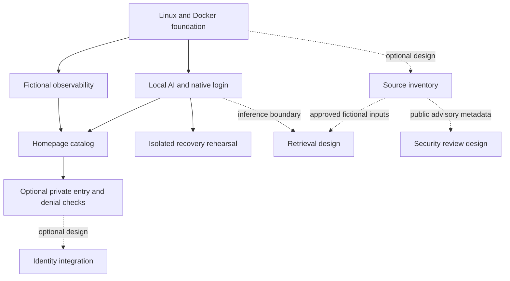

# The systems blueprint

OUTLANDS is a modular private workspace: a host foundation, independently
protected applications, a catalog, observability, and a repeatable engineering
method. This public map explains roles and interfaces using fictional examples.
It is not a real host inventory. `server-01` is the published reference role.

Arrows describe the example's learning order. They do not create network routes,
shared credentials, an ingestion pipeline, or an installation dependency.

## Systems and public coverage

| Role / planner ID | What the repository supplies | Acceptance boundary |
| --- | --- | --- |
| Host foundation / `foundation` | [Linux/Docker foundation](../modules/foundation/docker-host/README.md), blank configuration and isolated smoke fixture | Reader selects and installs supported software; daemon privileges and recovery require separate review. |
| Local AI / `ai` | [Ollama + Open WebUI](../modules/ai/ollama-open-webui/README.md), CPU default, optional GPU overlay, inference helper | Reader chooses models and resources privately; hosted inference does not qualify reader hardware or data handling. |
| Observability / `observability` | [Fictional metrics](../modules/observability/synthetic-metrics/README.md) and [optional host-health examples](../modules/observability/host-health/README.md) | Synthetic freshness is distinct from live collection, alert delivery, coverage and retention. |
| Catalog / `catalog` | [Homepage module](../modules/catalog/homepage/README.md) with invented links | Every destination retains its own authentication and denial checks. |
| Private entry / `private-entry` | [Route trial and access worksheet](../modules/access/private-entry/README.md) | Local success does not establish remote policy or denied-device behavior. |
| Identity / `identity` | [Identity walkthrough and static demo](11-identity.md); design only in the integrated planner | No shared-login adapter or account migration is supplied. Preserve native recovery access. |
| Recovery / `recovery` | [Disposable volume archive/restore rehearsal](../staging/server-01/README.md) | Rehearsal coverage only; no real backup destination, archive or restoration result is published. |
| Source inventory / `source-inventory` | Contract below; design only | No filesystem scanner, private repository connector or authorship inference is included. |
| Retrieval / `retrieval` | Contract below; design only | No document collection, embedding store, ingestion or model admission is enabled. |
| Security review / `security-review` | Contract below; design only | No target discovery, active testing, vulnerability scanner or automated remediation is included. |

`REFERENCE` in the [planner fixture](../tools/workspace-plan/systems.example.json)
means an inspectable guide or example exists. `REHEARSAL` means a disposable
method exists. `DESIGN_ONLY` means an interface is described but no integrated
runtime is supplied. None of these labels means deployed or accepted.

## Optional system contracts

**Source inventory:** start with an explicit set of reader-approved roots in a
private workspace. Define inclusion rules, exclusions, symlink handling and a
bounded scan before implementing a collector. Separate saved program/configuration
lines from prose, generated/vendor files and unsaved work. Counts do not establish
authorship, quality or ownership. A future public fixture should use invented
project IDs, aggregate counts, observation time and an explicit partial-coverage
flag; filenames and source paths remain private.

**Retrieval:** require admission and rights review before copying any source.
Use invented documents to test parse, chunk, index, retrieve and delete behavior.
Carry source IDs and limitations into answers. Treat document text as untrusted
data rather than instructions. Demonstrate refused inputs and access separation
before enabling any real connector. A successful parser check does not establish
permission, answer quality or safe retrieval from a private corpus.

**Security review:** accept public advisory metadata into a disposable fixture,
retain its primary source and observation time, and distinguish a product/version
match from confirmed exposure. Keep host inventory and findings private. Updates
need an independently reviewed change and recovery path; an advisory match never
triggers active testing or a repair. Research evidence, target details and
disclosure status belong outside this public blueprint.

Use the [offline planner](../tools/workspace-plan/README.md) to inspect an ordered
profile, then follow the [setup guide](26-workspace-setup.md). Implement new roles
one at a time using the [module contract](../modules/README.md), fictional fixtures,
bounded checks and an explicit statement of what remains untested.
