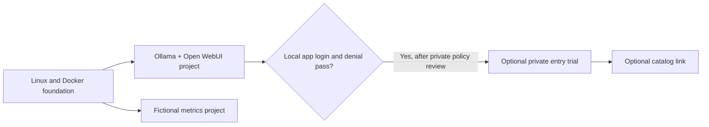

# Assemble a synthetic OUTLANDS host

`server-01` is a **role** for a reader-owned Linux host. This guide connects the published modules into one staged build. It is not a copy of anyone's server, an installer, or a record of a completed deployment. The [fictional assembly worksheet](assembly.example.json) starts every acceptance gate at `NOT_RUN`; copy the method into private records and replace it with evidence from your own isolated installation.



The AI and metrics projects are independent. The metrics example scrapes **only its own fictional fixture**. It does not read the host, Ollama, WebUI, Docker, or a user's activity. The private entry trial targets only the chosen application after its native login gate passes. It does not create a shared account or publish the metrics UIs.

## 1. Prepare the private decisions

Use a new test host or a clearly isolated staging context. Before starting services, record these choices **outside this public repository**:

| Decision | Public example | Private operator choice |
| --- | --- | --- |
| Linux and Docker | Supported host plus Compose plugin | Distribution, patching, daemon access, hardware, storage |
| Container images | Blank digest fields | Reviewed image digests, architecture, upstream licenses |
| Local browser ports | WebUI `3001`; Grafana `3002`; Prometheus `9090`, all on loopback | Free local ports and collision check |
| Secrets | Blank WebUI key; local Grafana password file | Generation, protection, retention, recovery |
| Persistent state | Separate named volumes for AI and metrics | Capacity, consistent backup, separate restore test |
| Remote access | No route by default | Narrow network policy and application assignment |
| Monitoring | Fictional scrape only | Separate review before any real target or retention policy |

Keep hostnames, addresses, user identities, model inventories, prompts, logs, credentials, network policy, and **every backup destination or provider** in private operator records. Do not paste a filled `.env`, `docker compose config` output, or a real dashboard export into a public issue. The public example does not choose a backup service.

## 2. Establish the host foundation

Follow the [Docker host foundation](../../modules/foundation/docker-host/README.md) on the chosen test host. Review Docker installation and privileged daemon access, verify the intended Docker context, resolve its blank image input to a reviewed digest, and run its disposable smoke example. That service has no network, port, or persistent volume. Keep the version and daemon details private.

**Gate:** Docker and Compose respond in the intended context, the smoke container exits successfully, and no unexpected host setting changed. If this fails, stop before adding applications. A source check or resolved Compose model alone does not satisfy this gate.

## 3. Add AI locally

Follow [Ollama + Open WebUI](../../modules/ai/ollama-open-webui/README.md) in its **own Compose project**. Choose reviewed image digests, create a stable private WebUI key, resolve Compose, then start only that project. CPU is the default; the optional one-GPU NVIDIA overlay requires a separate driver/toolkit review on an isolated test host. Confirm the Ollama API has no host port and WebUI binds only to the selected loopback port. Preserve the two named volumes and key together in the private recovery plan.

On a **new** WebUI data volume, create the first owner account locally. Disable sign-up in the effective Admin UI, sign out, and prove an unassigned user cannot register or view protected content. Select a model only after its own license and resource review; use a harmless fictional prompt for an inference check. Do not use private documents for a public tutorial.

**Gate:** native login and signed-out denial are observed in the running WebUI, a deliberately selected model responds to a fictional prompt, and a separate restore exercise demonstrates recovery. Keep the WebUI on loopback if any gate remains incomplete. The source checker does not prove these runtime outcomes.

## 4. Add fictional monitoring independently

Follow [synthetic metrics](../../modules/observability/synthetic-metrics/README.md) in a **second Compose project**. Set its three reviewed image digests and private Grafana password file. Resolve Compose before starting it. Confirm only the chosen Grafana and Prometheus loopback ports publish; the fixture has no host port. Do not attach either project to a common service network for this tutorial.

In Grafana's native UI, verify the fictional dashboard and the `fresh`, `stale`, `unavailable`, and recovered states. Check that login denies signed-out access. A healthy scrape (`up=1`) and fresh source observation are separate findings. The dashboard is not a host-health report and is not wired to the AI project.

**Gate:** the native dashboard and denial checks pass on the chosen image releases. Keep Grafana and Prometheus local; do not add a route to them by copying the WebUI route. Their state and restore checks are separate from the AI volumes.

## 5. Trial private entry only after local authorization

The [private entry module](../../modules/access/private-entry/README.md) is optional. Inspect existing routes and policy privately before a foreground Tailscale Serve trial to the selected **WebUI loopback port**. First prove WebUI's native login and registration denial. Then test intended-owner access, signed-out denial, app-unassigned denial, network-unassigned denial, direct URL access, public-internet reachability, and trial route removal. Record minimal outcomes privately. Do not enable Funnel or replace the app's native login.

**Gate:** every allowed and denied case passes on the actual test route, and stopping the trial leaves unrelated routes intact. The optional [Homepage catalog module](../../modules/catalog/homepage/README.md) starts with dead fictional links. Add a real destination only in a private copy after that destination gate is accepted. A catalog link is navigation, not authorization; a remotely routed catalog needs its own access gate.

## 6. Record acceptance and recoverability

Start a private copy of the [fictional worksheet](assembly.example.json). Keep each result `NOT_RUN` until you have direct evidence from the chosen test host. Record observation time, selected version, expected result, actual result, and a private evidence reference. A failed or unavailable check stays failed or unavailable; do not convert absence to success. Do not publish screenshots, logs, routes, accounts, or recovery material.

| Cross-module check | Initial result |
| --- | --- |
| Correct Docker context, foundation smoke, and daemon access | NOT RUN |
| AI project loopback boundary, native owner login, registration denial, fictional inference | NOT RUN |
| AI volumes and stable key restored in a separate test project | NOT RUN |
| Metrics project loopback boundary, native login, fictional modes | NOT RUN |
| Metrics state restored separately | NOT RUN |
| Optional private route allowed and denied cases, then exact route removal | NOT RUN |
| Optional catalog link reaches the protected app without bypassing its login | NOT RUN |

Change one module at a time. Before an update, preserve its settings and state through a privately reviewed backup method, read that module's upstream release notes, and prove restoration in an isolated project. Afterward repeat its boundary and user-visible checks, plus any affected cross-module gate. `docker compose down` does not itself erase named volumes; avoid `down -v` on state you intend to keep. Do not infer that an older image can read data migrated by a newer release.

## Offline source check

From the repository root, these commands read the public fixtures. They do not install packages, pull images, start containers, reach a tailnet, or test a browser:

```sh
python3 -I -B hosts/server-01/check_assembly.py
python3 -I -B -m unittest discover -s hosts/server-01 -p 'test_*.py'
python3 -I -B scripts/check_public_source.py
```

The checker verifies that the public worksheet names only the reviewed modules, retains independent projects and fictional inputs, and claims no completed acceptance. It cannot validate a reader's private choices, native UI, service wiring, recovery, or authorization. Those remain `NOT_RUN` here.
