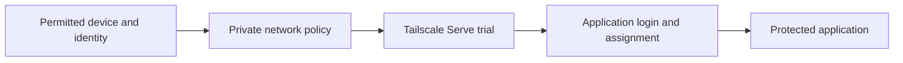

# server-01 private entry: a staged access boundary

This optional module teaches how to connect a **locally protected** service to a private route while testing both network reachability and application authorization. It is a fictional reference, not a tailnet policy, account export, route inventory, or deployment script. The [example review](access-review.example.json) uses reserved `example.invalid` and loopback addresses with every result `NOT_RUN`.

The [server-01 host](../../../hosts/server-01/README.md) and [AI module](../../ai/ollama-open-webui/README.md) work without this route. Keep their default local-only posture until the checks below are ready. Nothing in this repository runs automatically. The foreground Serve command later in this guide changes route state only when a reader deliberately runs it; enrollment, policy, and certificate setup remain separate owner-controlled steps.

## Two separate decisions



Serve makes a local service available within a tailnet under its access rules; it does not grant a user an application role. A successful catalog login also does not protect a direct app URL. Tailscale [Serve](https://tailscale.com/docs/features/tailscale-serve) and [Funnel](https://tailscale.com/docs/features/tailscale-funnel) have different exposure. This module uses a foreground Serve trial only after the application's own login is configured. It never enables Funnel or public router forwarding.

## 1. Complete the local application gate

For the [synthetic Ollama/Open WebUI example](../../ai/ollama-open-webui/README.md), finish first-owner creation on loopback, disable sign-up in the Admin UI, sign out, and confirm new registration is denied. Check the actual image release's [Open WebUI environment reference](https://docs.openwebui.com/reference/env-configuration/): some settings persist in the database, so changing an environment variable later may not change the effective setting. Keep native WebUI authentication enabled. Confirm that the container still publishes only on `127.0.0.1` and Ollama has no host port. If the app gate fails, stop here.

This module does not prescribe an identity provider or replace app sign-in. If you add an external gate, prove every protected path traverses it and that direct routes cannot bypass it. The broader [access QA guide](../../../docs/03-access-and-qa.md) covers this separately.

## 2. Review network policy and existing routes privately

Install and enroll Tailscale through its [official instructions](https://tailscale.com/docs/install/linux) on a reader-controlled test host. Tailscale Serve requires HTTPS certificates to be enabled for the tailnet, and its [access rules](https://tailscale.com/docs/reference/syntax/policy-file) apply to the served service. Use the administration UI and policy tools for your selected release to authorize only the intended device and identity. Do not copy a broad all-members policy from an example. Never put your tailnet name, route, ACL/grant export, account email, device ID, or certificate material in this repository or a public issue.

Inspect the current Serve state before proposing a new route:

```sh
tailscale serve status
```

The output may reveal private names and routes; keep it private. If a route already occupies the intended listener, do not overwrite it. Review the selected app's external URL and allowed-host behavior against its release before a route trial. The reserved `https://workspace.example.invalid/` in the fixture is illustrative and is **not** a URL provisioned by Serve.

## 3. Run a foreground trial on an isolated node

After the local app and the narrow network policy are verified, a reader on a node with no conflicting Serve route can try the documented reverse proxy form:

```sh
tailscale serve http://127.0.0.1:3001
```

Use the actual loopback port selected in your private app settings. Review the URL and tailnet-only scope that Serve prints; do not publish that output. This command starts a foreground route and can change the node's active Serve state. Do not run it on a shared or production node without checking its existing configuration and owner change process. Stop the trial with Ctrl+C; confirm `tailscale serve status` no longer shows the trial route. Do not use `tailscale serve reset` to clean up a shared node. If later choosing a background route, follow the current [Serve CLI lifecycle](https://tailscale.com/docs/reference/tailscale-cli/serve/) and remove only the exact route you own.

## 4. Prove both allowance and denial

Copy the *method*, not the example review file, into private operator records. Use only accounts and devices you own or are authorized to test. Run each case in a fresh browser session and record a minimal private result; a status code or redirect alone can miss protected content already returned.

| Case | Expected result | Reader's result |
| --- | --- | --- |
| Intended owner on permitted device | App opens after its native login | NOT RUN |
| Signed-out direct app URL | No protected content | NOT RUN |
| Network-permitted but app-unassigned user | App denies protected content | NOT RUN |
| Network-unassigned device or identity | Private route denied or unreachable | NOT RUN |
| Direct app URL without visiting the catalog | Same app authorization applies | NOT RUN |
| Public internet without tailnet access | No reachable route | NOT RUN |
| Trial stopped with Ctrl+C | Trial route absent; unrelated routes preserved | NOT RUN |

Treat a failed or unrun denial case as incomplete. Never use a mutation endpoint to test a purported read-only view. Do not include cookies, authorization headers, screenshots, logs, or private URLs in public reports. A physical-device test is separate from desktop viewport emulation.

## 5. Roll back and decide on persistence

The foreground trial should end when its process ends; verify by reading Serve status. Keep the app on loopback and its native login intact. If the test fails, remove only your trial route and investigate the specific policy or app gate; never reset all Serve routes or weaken the policy to make a page open. Persist a route only after the allowed and denied cases pass and you have a scoped removal plan. A later identity integration, route edit, app upgrade, or certificate change calls for repeating the affected cases.

`check_example.py` verifies only that the checked-in fixture remains fictional and every result stays `NOT_RUN`; its tests exercise rejected real-route shapes and unearned PASS labels. It sends no traffic and cannot assess a real tailnet. The published module makes no claim that any reader's route, authorization, or rollback was accepted. Upstream Serve and Open WebUI references checked 2026-10-30.
